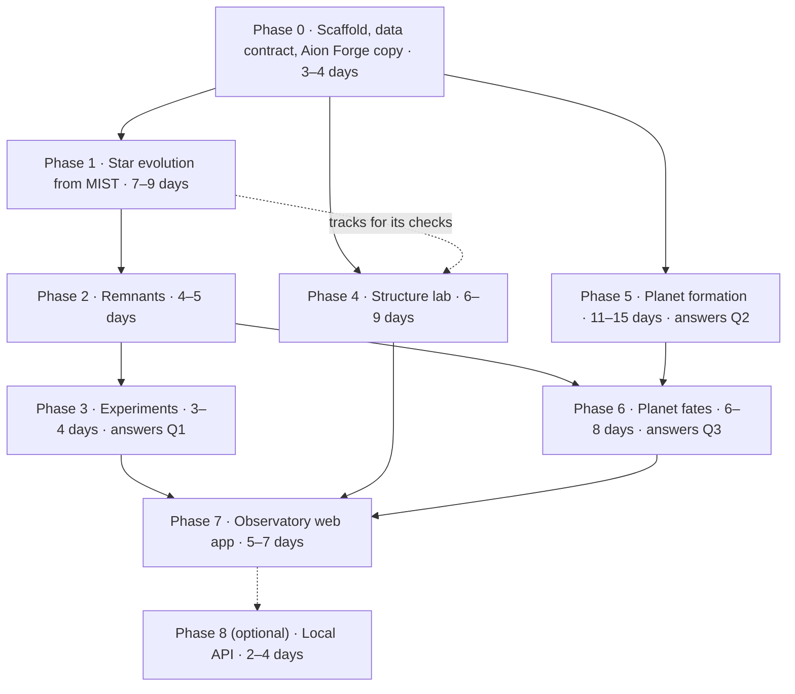
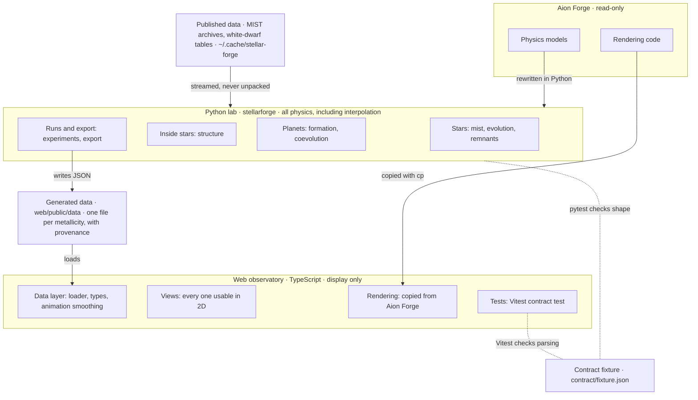

# Stellar-Forge Build Plan

Nov 6, 2026 · @Mayukh · revised after source checks and the outside review

Stellar-Forge is built in nine phases (0–8), entirely on this machine: Python computes every result from published physics, a TypeScript observatory only displays it, and one shared JSON fixture keeps the two in step. The first visible milestone is the Sun's track on an HR diagram in the browser at the end of Phase 1; your questions on lifetimes, remnants and planets are answered by Phases 3, 5 and 6. Every reference and 50 specific claims were checked against their sources on 6 November 2026 — see [Source checks](Source%20checks.md).

## Changes in this revision

- **Source checks:** all 56 references match their published records. Of 50 claims, 32 held, 11 were tightened and 6 were corrected:
    - MIST v1.2 evolves stars to the end only for [Fe/H] ≥ −2.0; below that, tracks stop after core helium burning.
    - MIST stops stars of 0.7 M☉ and below at the end of the main sequence.
    - MIST v2.5 was released in February 2026 and is now an open question.
    - Earth is engulfed when the Sun is a red giant.
    - The pair-instability gap's lower edge barely depends on metallicity.
    - Neutron-star masses are now checked against measurements, not against Fryer's convention.
- **Outside review applied:**
    - Python owns all scientific interpolation; web sliders snap to an exported grid.
    - The data contract carries units and provenance, and every result is labelled by where it came from.
    - Phase 4 is split into milestones, and Phase 1 starts with a MIST coverage report.
    - Remnant records keep both prescriptions; planet results are labelled by calibration range.
    - Checks are sorted into three kinds; the observatory gains a provenance panel and a prescription toggle.
- **Workflow:** Claude may commit and push, asking you first each time. Docs and downloaded references live in `documentation/`; downloaded material stays out of Git.
- **Effort:** now 45–61 working days, up from 40–57.

## At a glance



Q1 = lifetimes and remnants against mass and metallicity · Q2 = how many planets form, of which types · Q3 = what happens to them as the star ages.

Phases 1, 4 and 5 can each start once Phase 0 is done; Phase 4's final checks wait for Phase 1, and Phase 6 waits for Phases 2 and 5. The 45–61 days leave out the optional Phase 8. They are focused-effort estimates, not deadlines: Phase 0's benchmark resets them, and validation is never cut to meet them.

## Ground rules

Seven rules hold in every phase; a change that breaks one is rejected in review.

1. **Published physics, not a full stellar code.** Every model names the paper or dataset it implements, its claims are checked against that source (see [Source checks](Source%20checks.md)), and every phase passes its validation checks.
2. **Python owns all physics, including interpolation.** TypeScript never contains a physical formula and never blends two tracks: sliders snap to the grid Python exported, and TypeScript only smooths animation along one exported track. It also draws axes and scales and runs camera, animation and shader maths. Luminosity, radius, colour, orbits, habitable zones and horizon radii all arrive in the JSON.
3. **One shared JSON contract, with units and provenance.** `contract/fixture.json` is checked by a pytest test and a Vitest test, and both sides assert the same `schema_version`. Field names carry their units, and every export carries the `meta` block described in Data contract and provenance. A format change on either side fails a test until both sides are updated.
4. **Aion Forge is read-only.** Only read-only commands touch its folder: reading files, `git rev-parse` and checksums. Nothing that writes ever runs there — no npm, builds, tests, formatters or git writes. Files are copied out with `cp`, and checksum manifests taken before and after must match.
5. **Everything runs on this machine.** No phase needs cloud compute, and one local command runs every check. A GitHub Actions run of the fast tests is optional, never required.
6. **Every result says where it came from.** Each value is labelled as a published input (a MIST track point), interpolated, derived by Stellar-Forge, or a model prediction, with its validity flags. The observatory shows that label next to the value.
7. **Git: commits and pushes need your yes.** Claude may commit and push, but asks you first every time.

## This machine

This is a 4-core desktop with 15 GiB of RAM, 44 GB of free SSD space and a 2009-era GPU. CPU and memory are enough for every phase; disk space and the GPU shape the plan.

| Part | What you have | What it means for Stellar-Forge |
| --- | --- | --- |
| CPU | Intel Core i3-10105F: 4 cores, 8 threads, up to 4.4 GHz, AVX2 and FMA | NumPy and SciPy run well; parallel jobs use at most 4 worker processes |
| Memory | 15 GiB RAM, 7.2 GiB available when checked; 2 GiB swap | Each job stays under 4 GiB; nothing relies on swap |
| SSD | 256 GB NVMe, 44 GB free (81% used) | All working data must fit in about 5 GB |
| External HDD | 2 TB WD Elements, NTFS, mounted under another account (lawsikho) | This account cannot read it, so the plan does not depend on it |
| GPU | NVIDIA GeForce G210, 1 GB, open-source nouveau driver; WebGL 2 works through ANGLE on OpenGL 3.3 | 3D views stay light, and every core view also works in 2D |
| System | Ubuntu 22.04.5 LTS, kernel 6.8, desktop (no battery) | Long background runs are safe |
| Python | 3.10.12 with NumPy 2.0.1, SciPy 1.15.3, pandas 2.3.3, Matplotlib 3.9.1 | 3.10 reached end of life in October 2026, so the project gets its own Python 3.12 environment |
| Node | Node 22.14.0, npm 11.6.1 | Recent enough for the Vite, React and Three.js stack copied from Aion Forge |
| Other tools | gcc 11.4, make, git 2.34, gh 2.102, Docker 29.8, pdftotext; no gfortran, no uv | uv is installed in Phase 0; gfortran is not needed because MESA is out of scope |
| Browsers | Chrome 153, Firefox 158 | The web app is tested in both |
| Network | MIST data server reachable; one archive per metallicity, 76–107 MB each as MIST lists them | The rotating v1.2 grid is about 1.5 GB to download |

Checked on 6 November 2026 with `lscpu`, `free`, `df`, `lsblk`, `lspci`, a WebGL probe and size-only requests to the MIST server.

## Machine budget

Every phase fits this machine if raw data is streamed instead of unpacked, jobs use at most four processes, and 3D stays light.

| Resource | Budget | How the plan stays inside it |
| --- | --- | --- |
| SSD space | about 5 GB for the whole project | MIST archives (about 1.5 GB) are read straight from their compressed files; processed grids about 0.4 GB; web data about 150 MB; reference papers about 25 MB; results capped at 1 GB |
| Memory | under 4 GiB per job | MIST is converted one metallicity at a time; the processed grid for all 15 metallicities is about 0.4 GB as float32 |
| CPU | 4 worker processes | Each worker pins its maths library to 1 thread (`OMP_NUM_THREADS=1`) so workers do not fight over cores |
| GPU | light 3D only | Pixel ratio 1, redraw only on change, lowest shader quality by default, a 2D version of every view |
| Time | no single job over about 40 minutes | Long jobs run in the background, save progress per metallicity or grid cell, and resume after a stop |

| Job | Size | Estimated time on this CPU |
| --- | --- | --- |
| Download MIST | 15 archives, about 1.5 GB | depends on your connection; resumable |
| Convert MIST to compact grids | 15 metallicities | 15–40 min, once; Phase 1 times one archive first |
| Build one star's track | 1 mass and metallicity | under 50 ms |
| Export the web track grid | 200 masses × 46 metallicities | a few minutes |
| Lifetime and remnant sweep | 200 masses × 46 metallicities (main sequence) or × 26 (full life) | under 2 min |
| Solve one zero-age main-sequence model | 1 star | 1–10 s |
| Planet population grid | 5,000 systems in each of 120 cells | 10–40 min on 4 workers |
| Export everything for the web | all phases | under 5 min |

These times are estimates; Phase 0 runs a short benchmark on this machine and replaces them with measured numbers.

**Out of scope on this machine** — each is replaced by a published model or a light visual (rule 1):

- running MESA or any full stellar-evolution code
- N-body integration of whole planetary systems over billions of years
- hydrodynamic simulations of disks or supernovae
- full-resolution ray-traced 3D effects

## Architecture



Python computes every number once and writes it to JSON with its provenance; the web app only loads and draws it. Aion Forge feeds both sides through copies and rewrites, and is never written to.

## Repository layout and toolchain

Stellar-Forge is one Git repository: a Python package for the physics, a `web/` app for display, a `contract/` folder that both sides test against, and `documentation/` for every document.

```
Stellar-Forge/
├── stellarforge/            Python: all physics
│   ├── mist.py              read MIST archives into compact grids; coverage report
│   ├── evolution.py         star tracks for any mass and metallicity (EEP interpolation)
│   ├── remnants.py          white dwarfs, neutron stars, black holes
│   ├── structure.py         polytropes and the zero-age main-sequence solver
│   ├── imf.py binary.py activity.py colour.py   ported from Aion Forge
│   ├── planets/             disk, growth, migration, population, classify,
│   │                        coevolution, escape, mass_radius
│   ├── experiments.py       mass × metallicity sweeps (command line)
│   └── export.py            writes contract-shaped JSON with provenance
├── contract/
│   ├── fixture.json         the one shared fixture
│   └── README.md            every field, with units
├── tests/                   pytest; never needs the MIST download
├── scripts/                 fetch_mist.py, bench.py
├── web/                     Vite + React + TypeScript + Three.js
│   ├── src/rendering/       copied from Aion Forge, adapted
│   ├── src/data/            loader, types, animation smoothing (no science)
│   ├── src/views/           one folder per view
│   └── public/data/         generated JSON (not committed)
├── results/                 experiment outputs (not committed)
├── documentation/           every document
│   ├── Stellar-Forge Build Plan.md
│   ├── Source checks.md
│   ├── data/                generated dataset reports, such as the MIST coverage report
│   └── references/          downloaded papers, web pages and metadata (kept out of Git); index and check scripts
├── PROVENANCE.md            every file taken from Aion Forge
├── CLAUDE.md                the ground rules, for future sessions
├── Makefile
└── pyproject.toml
```

Reference material lives in `documentation/references/`. Bulk model data (MIST archives, white-dwarf tables) lives in `~/.cache/stellar-forge/`, so Git never holds gigabytes.

| Tool | Version | Used for |
| --- | --- | --- |
| Python (installed with uv) | 3.12 | the `stellarforge` package, in `.venv/` |
| NumPy, SciPy, pandas, Matplotlib | current releases, pinned in `pyproject.toml` | arrays, ODE solving, MIST parsing, publication figures |
| pytest, ruff | current releases | tests and linting |
| Node, npm | 22.14, 11.6 (already installed) | the web app |
| Vite, React, TypeScript, Three.js, Vitest, ESLint | the versions in Aion Forge's `package.json` | build, interface, 3D, tests |
| FastAPI, uvicorn | added only in Phase 8 | the optional local API |

| Command | What it does |
| --- | --- |
| `make setup` | creates `.venv` and installs the Python and npm packages |
| `make data` | downloads MIST (resumable) and builds the compact grids |
| `make export` | writes all web JSON into `web/public/data/` |
| `make check` | ruff, pytest, TypeScript compile, ESLint and Vitest; must pass before every commit |
| `make dev` | starts the web app on `localhost` |

Each phase gets its own branch, merged into `development` once its "Done when" is met. Claude commits and pushes only after asking you. The remote is `IronMax-Hub/Stellar-Forge` on GitHub, and it is public.

## Data contract and provenance

Every export carries a `meta` block, so any result can be reproduced and read correctly without this plan.

| `meta` field | Example | Why it is there |
| --- | --- | --- |
| `schema_version` | `1` | both contract tests compare it |
| `generator` | `stellarforge 0.1.0`, git commit | the exact code that made the file |
| `dataset` | `MIST v1.2, v/vcrit = 0.4` | which published data the numbers came from |
| `models` | `{"remnant": "fryer2012-delayed", "ifmr": "cummings2018-mist"}` | which prescription produced each result |
| `inputs` | `{"mass_msun": 1.0, "feh": 0.0}` | the run's parameters |
| `seed` | `12345`, or `null` | random draws repeat exactly |
| `created` | `2026-11-06T12:00:00Z` | when it was made |
| `references` | DOIs of the sources used | every number traces to a paper |

- **Units in names:** fields end in their unit (`_msun`, `_lsun`, `_rsun`, `_k`, `_yr`, `_au`, `_mearth`), and logs start with `log_`. There is no bare `mass`, `age` or `temperature`.
- **Provenance per value:** each value or track says whether it is published, interpolated, derived or predicted (rule 6).
- **Validity flags:** these are warnings, never silent fixes. Examples: `near_grid_boundary`, `nearest_track_used`, `track_ends_after_core_he_burning`, `outside_calibration_range`.
- **Uncertainty:** where a model gives ranges or alternatives, the export keeps them, such as both remnant prescriptions, instead of one number.

## Phase 0 — Scaffold, data contract and the Aion Forge copy

**Goal:** an empty but working project in which `make check` passes on both stacks and the copied rendering code compiles.

**Steps**

1. Install uv in your home folder and create `.venv` with Python 3.12; the system Python 3.10 stays untouched.
2. Create `pyproject.toml` (NumPy, SciPy, pandas, Matplotlib, pytest, ruff) and the empty `stellarforge` package with `SCHEMA_VERSION = 1`.
3. Create `web/` from Aion Forge's config files, copied with the read-only procedure and then trimmed of Capacitor and Android.
4. Write contract version 1: `contract/fixture.json` with the full `meta` block and a small `track` block whose field names carry units.
5. Add the two contract tests. `tests/test_contract.py` builds a document with `export.py` and compares its shape to the fixture; `web/src/__tests__/contract.test.ts` parses the fixture with the app's own loader and checks every field type.
6. Copy the rendering files with the read-only procedure (see Reuse from Aion Forge). Review each copy for hidden dependencies before accepting it, and record it in `PROVENANCE.md`.
7. Make the copies compile against Stellar-Forge's types, stubbing anything that depends on Aion Forge's world simulation.
8. Add the `Makefile`, extend `.gitignore` (`.venv`, `node_modules`, `web/public/data`, `results`; downloaded reference material is already excluded), and write a project `CLAUDE.md` holding the ground rules.
9. Run `scripts/bench.py` to measure NumPy speed and xz decompression here, and replace the estimates in Machine budget.
10. Turn the verified references into `stellarforge/references.json` (key, citation, DOI), which the exporter uses for `meta.references`.

**How the contract test works:** pytest checks shape, not values — the same keys, value types and consistent array lengths. Physics values are checked by separate numerical and scientific tests (see Validation), so improving a model never breaks the contract. Each later phase adds its block to the fixture and raises `schema_version` by one.

**Delivers:** an empty web app showing one test star coloured from the fixture's `rgb`, both test suites, `PROVENANCE.md`, `CLAUDE.md` and `references.json`.

**Machine cost:** about 0.5 GB for `node_modules` and `.venv`; minutes of compute.

**Done when:** `make check` passes, `make dev` shows the test star, and the Aion Forge checksum manifest is unchanged.

**Effort:** 3–4 days.

## Phase 1 — Star evolution from MIST tracks

**Goal:** the full life of any star from 0.1 to 300 M☉ for [Fe/H] −2.0 to +0.5, and its main sequence and helium burning down to [Fe/H] −4.0, shown on an HR diagram in the browser.

**Published basis:** the MIST v1.2 evolutionary tracks (Choi et al. 2016; Dotter 2016), computed with the MESA code. A MIST track is a result of that published model, which Stellar-Forge processes and presents; it is not a new first-principles calculation. Coverage, as checked against Choi et al. 2016 and the MIST website:

| Part of the grid | How far MIST follows the star |
| --- | --- |
| [Fe/H] −2.0 to +0.5 (11 metallicities) | to the white-dwarf cooling sequence or the end of carbon burning |
| [Fe/H] −4.0 to −2.5 (4 metallicities) | only to the end of core helium burning |
| Stars of 0.7 M☉ and below | to the end of the main sequence, which takes over 35 Gyr at 0.7 M☉ |
| Rotation | v/vcrit = 0.4 by default; a non-rotating set is also released |

MIST v2.5 (released 24 February 2026; Dotter et al. 2026, in press) adds α-enhanced grids and may cover low metallicities more fully; whether to use it is an open question.

**Steps**

1. `scripts/fetch_mist.py` downloads one archive into `~/.cache/stellar-forge/mist/` first, resuming after interruptions and checking its size.
2. `python -m stellarforge.mist inventory` writes `documentation/data/MIST coverage.md`. For each metallicity it lists the masses present, EEP counts, how each track ends, and the column names and units read from the header.
3. Convert that archive and time it, then fetch and convert the rest. Each archive is read in place with Python's `tarfile` module, never unpacked. About 20 columns are kept as float32 — age, current mass, log L, log Teff, log R, log g, helium and carbon–oxygen core masses, central hydrogen and helium, central temperature and density, and MIST's `phase` label — in one `.npz` file per metallicity.
4. `stellarforge/evolution.py` builds a track for any mass and metallicity by interpolating at the same equivalent evolutionary phase (EEP), in log mass and [Fe/H]. Safeguards:
    - interpolate only inside a documented valid grid cell, where all four corner tracks exist and share the EEPs needed;
    - never blend tracks that end differently: white-dwarf cooling, carbon burning, stopped after core helium burning, stopped at the end of the main sequence;
    - treat missing grid points explicitly and refuse to extrapolate;
    - near a boundary, use the nearest valid track with a flag rather than an invalid blend;
    - record the method (grid track, EEP interpolation or nearest track) and its validity flags on every exported track.
5. It exposes `Star(mass, feh)` with `.track()`, `.at(age)` and `.phases()`. Phases follow MIST's labels: pre-main sequence, main sequence, red giant branch, core helium burning, early and thermally pulsing AGB, post-AGB and Wolf–Rayet.
6. `export.py` writes the web grid, computed in Python: 200 log-spaced masses × 46 metallicities ([Fe/H] −4.0 to +0.5 in 0.1 dex steps). Each track has 150–250 points including every primary EEP, values rounded to 4–5 significant digits, unit-suffixed fields, `rgb` for display and its provenance. That is about 2–3 MB per metallicity file.
7. Web view **Star Builder**:
    - mass and [Fe/H] sliders that snap to the exported grid values;
    - an age scrubber that smooths animation between neighbouring points of one track (display only);
    - an SVG HR diagram, a star sphere coloured by `rgb` and sized by radius, and a phase timeline;
    - a numbers panel that shows each value's provenance label.

**Checks** (numbers in Validation): the Sun at 4.57 Gyr; leave-one-out interpolation accuracy; the coverage report agreeing with Choi et al. 2016; metallicity trends at fixed mass.

**Known limits:** with v1.2, stars below [Fe/H] −2.0 stop after core helium burning, so their remnants and late phases are not shown. Stars of 0.7 M☉ and below stop at the end of the main sequence, which they have not reached in the universe's 13.8 Gyr.

**Machine cost:** a 1.5 GB download; 15–40 minutes of one-time conversion; under 1 GB of RAM at a time; about 150 MB of web data.

**Done when:** the Sun check passes, the coverage report is written, leave-one-out errors are reported, and Star Builder responds in under 50 ms per slider move.

**Effort:** 7–9 days.

## Phase 2 — Remnants: white dwarfs, neutron stars, black holes, pair instability

**Goal:** the final remnant — its type, mass and basic properties — for every grid star whose track reaches its end, with the prescription and its limits visible.

| How the star ends (read from its track) | Remnant | Rule implemented | Source |
| --- | --- | --- | --- |
| Track reaches the white-dwarf cooling sequence | White dwarf | Final core mass from the MIST track, checked against the MIST-based initial–final mass relation (0.080 Mi + 0.489 M☉ for 0.83–2.85 M☉; scatter 0.06 M☉) | Cummings et al. 2018 |
| Super-AGB window, 9.0–9.25 M☉ in the fiducial model | Neutron star from an electron-capture supernova | Optional; the window moves with mixing and mass-loss assumptions | Poelarends et al. 2008 |
| Track ends at carbon burning | Neutron star or black hole | "Rapid" and "delayed" prescriptions from carbon–oxygen core mass and final mass, both kept; neutron star below Fryer's 2.5 M☉ dividing line | Fryer et al. 2012 |
| Helium core of about 40–65 M☉ (thresholds differ between papers) | Black hole capped near 40–45 M☉ | Pulsations shed the excess mass | Heger & Woosley 2002; Woosley 2017; Belczynski et al. 2016; Farmer et al. 2019 |
| Helium core of 64–133 M☉ | None: the star is destroyed | Pair-instability supernova | Heger & Woosley 2002 |
| Helium core above 133 M☉ | Black hole by direct collapse | The whole star collapses | Heger & Woosley 2002 |
| Track stops at the end of the main sequence (0.7 M☉ and below) | None yet | Labelled "still on the main sequence" | Choi et al. 2016 |
| Track stops after core helium burning ([Fe/H] below −2.0 in v1.2) | Not predicted | Labelled "track incomplete"; no remnant shown | Choi et al. 2016 |

Every threshold is a named constant in `remnants.py`, with its citation in a comment.

**What every remnant record carries:**

- type and mass;
- the adopted prescription and the alternative prescription's result;
- the initial mass and metallicity;
- validity flags and known limitations.

The record also says it assumes a single star. Most massive stars interact with a companion (Sana et al. 2012), so binary channels are not covered, and no remnant mass is presented as uniquely determined by the initial mass.

**Steps**

1. `remnants.py` takes the track's last state (final mass, helium and carbon–oxygen core masses, how the track ends) and returns the record above.
2. White-dwarf cooling uses the published cooling tracks of Bédard et al. 2020 — luminosity and temperature against cooling age for each white-dwarf mass — downloaded once into `~/.cache/stellar-forge/`.
3. Neutron stars get a fixed 12 km radius, inside the measured range of about 10–13 km (Özel & Freire 2016; NICER: Riley et al. 2019, Miller et al. 2019). Black holes get their horizon radius computed in Python and exported, so the web never computes it.
4. Export adds a `remnant` block to the contract (schema version 2) and a remnant table per metallicity.
5. Web view **Remnants**:
    - a card per remnant telling how it formed and which prescription produced it;
    - white-dwarf cooling drawn on the HR diagram;
    - the copied black-hole lensing view at its lowest quality.

**Checks** (numbers in Validation): initial–final masses at solar metallicity; neutron-star masses within the measured range; the lower edge of the pair-instability gap.

**Machine cost:** negligible compute; a few MB of tables.

**Done when:** every grid star has a remnant record (or a labelled reason it has none), the checks pass, and the Remnants view works.

**Effort:** 4–5 days.

## Phase 3 — Experiment runner: lifetimes and remnants across mass × metallicity

**Goal:** answer your first question — how lifetimes and final remnants change with mass and metallicity — with runs anyone can repeat exactly.

| Experiment | Grid | Output |
| --- | --- | --- |
| Main-sequence lifetime map | 200 masses (0.1–300 M☉, log-spaced) × 46 metallicities ([Fe/H] −4.0 to +0.5, step 0.1) | heatmap of main-sequence lifetime |
| Full-life map | 200 masses × 26 metallicities ([Fe/H] −2.0 to +0.5) with v1.2 | heatmap of total lifetime |
| Remnant map | the full-life grid, both Fryer variants | a type map: white dwarf, neutron star, black hole, no remnant, still on the main sequence |
| Remnant mass curves | 200 masses × 5 metallicities | final mass against initial mass, both prescriptions |
| Population outcome | Kroupa initial mass function, 10⁶ stars per metallicity | share of stars ending as each remnant; core-collapse events per 1,000 M☉ of stars formed |
| The Sun at other metallicities | 1 M☉ at [Fe/H] −2, −1, 0 and +0.3 | lifetime, colour and remnant side by side |

**Steps**

1. `experiments.py` exposes each experiment as a command, for example `python -m stellarforge.experiments lifetime-map --feh=-4:0.5:0.1 --masses=200`.
2. Every run writes `results/<experiment>/<timestamp>/` holding `result.json` (the contract's `experiment` block with its full `meta`), `figure.png` from Matplotlib and `run.json` (git commit, parameters, MIST version, machine benchmark).
3. Random draws, such as IMF sampling, use fixed seeds, so the same command gives byte-identical results.
4. Web view **Experiments**: heatmaps and curves read from the exported results, with values and provenance shown on hover.

**Checks** (numbers in Validation): shorter main-sequence lifetimes and heavier black holes at low metallicity; the IMF share of stars born above 8 M☉; which metallicities reach the pair-instability gap, reported as a Stellar-Forge result rather than tested against a published target.

**Machine cost:** each sweep under 2 minutes; results of tens of MB.

**Done when:** all six experiments run from the command line, produce figures and dashboard views, and rerun identically.

**Effort:** 3–4 days.

## Phase 4 — Structure lab: polytropes and a zero-age main-sequence solver

**Goal:** show hydrostatic equilibrium and energy generation from first principles, built in small steps and checked against MIST.

**Part A — polytropes.** Solve the Lane–Emden equation for n = 0 to 5 with SciPy. The cases n = 0, 1 and 5 have exact solutions, which serve as tests.

```latex
\frac{1}{\xi^{2}}\frac{d}{d\xi}\left(\xi^{2}\frac{d\theta}{d\xi}\right) = -\theta^{n}
```

Applied to the Sun, the n = 3 polytrope (Eddington's standard model) gives a central temperature of 1.21 × 10⁷ K, against 1.571 × 10⁷ K in full solar models. That gap becomes a built-in lesson on what simple physics misses.

**Part B — zero-age main-sequence solver.** Four structure equations in the mass coordinate m, with ∇ the temperature gradient (radiative or convective):

```latex
\frac{dr}{dm} = \frac{1}{4\pi r^{2}\rho}, \qquad \frac{dP}{dm} = -\frac{Gm}{4\pi r^{4}}, \qquad \frac{dL}{dm} = \varepsilon, \qquad \frac{dT}{dm} = -\frac{GmT}{4\pi r^{4}P}\nabla
```

| Ingredient | Version 1 | Optional upgrade | Source |
| --- | --- | --- | --- |
| Equation of state | ideal gas plus radiation pressure | — | Kippenhahn, Weigert & Weiss 2012 |
| Opacity | Kramers bound-free and free-free, plus electron scattering | OPAL tables | Iglesias & Rogers 1996 |
| Energy generation | analytic pp-chain and CNO-cycle rates | NACRE rate fits | Angulo et al. 1999 |
| Convection | Schwarzschild criterion; adiabatic gradient in convective zones | — | Kippenhahn, Weigert & Weiss 2012 |
| Composition | uniform; X, Y and Z from [Fe/H] with MIST's helium scaling, Y = 0.249 + 1.5 Z | — | Choi et al. 2016 |

**Milestones** — each is a checkpoint with its own tests:

1. Analytic Lane–Emden cases (n = 0, 1, 5) match their exact solutions.
2. Numerical polytropes for n = 0 to 5 reproduce the published constants.
3. A simplified Sun-like zero-age model converges (fixed composition, ideal gas, constant opacity).
4. Kramers and electron-scattering opacity and pp and CNO energy generation are added.
5. Convection and the boundary and matching treatment are added. The fitting method integrates out from the centre and in from the surface, matches at half the mass, and solves for central pressure, central temperature, radius and luminosity with `scipy.optimize.root`. Starting guesses come from the MIST zero-age star of the same mass and metallicity.
6. The mass range is extended step by step (1 M☉, then 0.8–3 M☉, then up to 20 M☉), stopping where convergence fails, and the range reached is reported.

**Comparison with MIST:**

- **Where:** at MIST's zero-age main-sequence EEP, with the same X, Y and Z.
- **What:** luminosity, radius, central temperature and density, convective-core mass, and the pp and CNO shares.
- **Targets:** listed in Validation.

**Steps**

1. `structure.py` implements milestones 1–6 and exports polytrope profiles for n = 0 to 5 in steps of 0.5.
2. Export adds a `profile` block: mass, radius, pressure, temperature, density, luminosity, pp and CNO energy rates, opacity, gradients and a convective flag, all unit-suffixed.
3. Web view **Inside the Star**:
    - profile charts;
    - a cross-section showing convective and radiative zones around the burning core;
    - a polytrope explorer with an n slider that snaps to the exported values.

**Machine cost:** 1–10 s per model; a 30-mass × 3-metallicity grid in 3–15 minutes on 4 workers.

**Done when:** milestones 1–5 pass for a Sun-like star, and the mass range reached by milestone 6 is reported. The full 1–20 M☉ range is a goal, not a gate.

**Effort:** 6–9 days — the hardest numerics in the plan, and likely to need iteration.

## Phase 5 — Planet formation: how many planets form, and of which types

**Goal:** answer your second question — how many planets form, of which types, around which stars — as statistics over thousands of simulated systems, labelled by how well the model is calibrated there.

**Published basis:** the semi-analytic population synthesis of Ida & Lin (papers I–VI, 2004–2010). Metallicity enters through the solid material in the disk (Ida & Lin 2004a, eq. 11; 2004b), where f_g is the disk's gas-mass factor and η_ice the boost beyond the snow line:

```latex
\Sigma_{d} = 10\, f_{d}\, \eta_{\rm ice} \left(\frac{a}{1\,{\rm AU}}\right)^{-3/2} {\rm g\,cm^{-2}}, \qquad f_{d} = f_{g}\, 10^{[{\rm Fe/H}]}
```

| Ingredient | Rule | Source |
| --- | --- | --- |
| Gas disk | scaled minimum-mass solar nebula; log₁₀ f_g drawn from a Gaussian centred at 0 with σ = 1, cut off at f_g = 30 | Hayashi 1981; Ida & Lin 2004a, 2004b |
| Disk mass against star mass | both scalings run: roughly linear in M★ (measured, disks at 0.2–0.6% of the star; default) and ∝ M★² (Ida & Lin's standard case) | Andrews et al. 2013; Ida & Lin 2005 |
| Snow line | ice boost η_ice = 4.2 beyond 2.7 (M★/M☉)² AU; later upgrade: 2.7 (L★/L☉)^1/2 AU with MIST luminosity | Ida & Lin 2004a, 2005 |
| Disk lifetime | gas depletion time drawn between 1 and 10 Myr; disk fractions fall with an e-folding time of about 2.5 Myr | Ida & Lin 2004a; Mamajek 2009 |
| Embryos | seeded about 10 mutual Hill radii apart | Kokubo & Ida 1998; Ida & Lin 2004a |
| Core growth | oligarchic growth up to the isolation mass | Kokubo & Ida 2002; Ida & Lin 2004a |
| Gas capture | runaway accretion once the core passes a critical mass of about 10 M⊕, scaled by accretion rate and opacity (5–20 M⊕) | Ikoma et al. 2000; Ida & Lin 2004a |
| Migration | type II for gap-opening giants; type I damped by C1, default 0.03–0.1 (the range that matches observations) | Ida & Lin 2008a |
| Multiplicity | version 1: neighbouring feeding zones never overlap; version 2: rocky embryos cross orbits and merge after the gas is gone | Ida & Lin 2010 |

| Planet type | Rule (named constants, adjustable) |
| --- | --- |
| Rocky | under 2 M⊕, no envelope |
| Super-Earth | 2–10 M⊕, rocky, no lasting envelope |
| Sub-Neptune | 2–20 M⊕ with a hydrogen–helium envelope of a few percent |
| Ice giant | 10–50 M⊕, formed beyond the snow line, core-dominated |
| Gas giant | over 50 M⊕, built by runaway gas capture |

Radii come from the mass–radius relation ported from Aion Forge. That relation is the Chen & Kipping 2017 fit, whose break at 2.0 M⊕ also separates rocky worlds from larger ones.

**Calibration labels.** Every cell and result is labelled as one of:

- **Observational constraint:** survey data used as a check, never as model output.
- **Prediction inside the calibration range:** star masses 0.2–1.5 M☉ (the range Ida & Lin 2005 studied) and [Fe/H] −0.5 to +0.5 (where surveys constrain occurrence).
- **Parameter-sensitive:** a conclusion that changes within the sensitivity runs.
- **Extrapolation:** anything outside the calibration range.

**Steps**

1. Write `planets/disk.py`, `growth.py`, `migration.py`, `population.py` and `classify.py`, with one cited function per ingredient.
2. Vectorise with NumPy: arrays of systems × embryos, stepped in log time from 0.1 Myr until the gas disk is gone.
3. Run the default grid: 8 star masses (0.2–1.5 M☉) × 15 metallicities ([Fe/H] −4.0 to +0.5), 5,000 systems per cell, with a fixed seed per cell. Stars of 1.5–3 M☉ run only if you choose the wider range, labelled as extrapolation.
4. Run sensitivity checks: repeat key cells with C1, disk lifetime, disk-mass spread and the disk-mass scaling varied, and report which conclusions hold. Show results as ranges or distributions where a single number would hide that spread.
5. Record the full parameter set in every result's `meta`, and export per-cell statistics plus 200 sample systems per cell (the contract's `population` and `system` blocks).
6. Web view **Planets**:
    - the planet mass–distance diagram;
    - giant-planet occurrence against [Fe/H];
    - a planets-per-star histogram, with calibration labels on every panel;
    - a click-through from any sample system to the copied system view.

**Optional later, never a blocker:** pebble accretion (Lambrechts & Johansen 2012) as a second growth model, and published Bern-model populations (Emsenhuber et al. 2021) as an outside cross-check once the main model works.

**Checks** (numbers in Validation): giant-planet occurrence against metallicity and star mass; the giant fraction for a solar twin; the flat occurrence of warm super-Earths.

**Machine cost:** seconds per cell; the full grid in 10–40 minutes on 4 workers; under 0.5 GiB per worker.

**Done when:** the grid completes, every check is reported with its number and a pass or fail, and the Planets view shows calibration labels.

**Effort:** 11–15 days.

## Phase 6 — Planets through the star's life

**Goal:** answer your third question — what happens to each planet as its star ages, swells, sheds mass and dies — keeping the link between where a planet formed and what later happens to it.

| Process | Rule | Source |
| --- | --- | --- |
| Habitable zone | inner and outer edges from the star's luminosity and temperature over time; valid for 2,600–7,200 K, flagged outside it | Kopparapu et al. 2013, 2014 |
| Orbits widen as the star loses mass | orbit size × star mass stays constant while mass loss is slow compared with the orbit; eccentricity is kept | Veras et al. 2011; Schröder & Connon Smith 2008 |
| Tidal pull-in and engulfment by a giant | equilibrium tide in the convective envelope; a planet is engulfed once its orbit is inside the star | Zahn 1977; Verbunt & Phinney 1995; Villaver & Livio 2009; Mustill & Villaver 2012 |
| Atmosphere loss | XUV-driven escape judged against the cosmic shoreline, ported from Aion Forge; sub-Neptunes can be stripped to super-Earths | Zahnle & Catling 2017; Wright et al. 2011; Ribas et al. 2005; Owen & Wu 2017; Fulton et al. 2017 |
| Supernova | a circular orbit is unbound if more than half the system's mass is lost at once; eccentric orbits can survive near apastron; neutron-star kicks (σ = 265 km/s) lower survival further | Hills 1983; Hobbs et al. 2005 |
| After the star dies | survivors orbit the white dwarf on widened orbits; pulsar planets are described, not modelled | Wolszczan & Frail 1992 |

The plan models single stars. The binary stability limits ported from Aion Forge (Holman & Wiegert 1999) apply only if companion stars are added later. Planet fates need complete tracks, so with MIST v1.2 they run for [Fe/H] −2.0 to +0.5.

**Steps**

1. `planets/coevolution.py` steps each planet along its star's track, with finer steps on the giant branches, where the radius changes fast.
2. Every planet gets an event timeline: formed (with its formation conditions), enters and leaves the habitable zone, loses its atmosphere, is engulfed, is unbound, or survives around the remnant.
3. Export adds `events` to the contract's `system` block.
4. Web view **System Timeline**:
    - a 2D orbit map with a time scrubber: the star swells, the habitable zone moves out, orbits widen, and engulfed planets vanish;
    - an event log;
    - the optional 3D system view.

**Checks** (numbers in Validation): the Solar System's fate; when Earth leaves the habitable zone; supernova survival.

**Machine cost:** milliseconds per planet; every sample system in under a minute.

**Done when:** every sample system has a timeline, representative cases match the literature (the Solar System above all), and System Timeline works.

**Effort:** 6–8 days.

## Phase 7 — The observatory web app

**Goal:** one local web app that ties every view together, runs smoothly on the G210, and shows where every number came from. Each view is built in its own phase; this phase connects and polishes them.

| View | Shows | Built in | Drawing |
| --- | --- | --- | --- |
| Star Builder | HR track, the star, its phases | Phase 1 | 2D SVG plus a light 3D sphere |
| Remnants | white-dwarf cooling, neutron stars, black holes | Phase 2 | cards plus black-hole lensing (3D, low quality) |
| Experiments | lifetime and remnant maps, remnant-mass curves, IMF shares | Phase 3 | 2D |
| Inside the Star | profiles, cross-section, polytropes | Phase 4 | 2D |
| Planets | planet mass–distance diagram, occurrence against [Fe/H], calibration labels | Phase 5 | 2D |
| System Timeline | orbits, habitable zone and events over time | Phase 6 | 2D, optional 3D system view |
| Provenance panel | for any value: dataset, model, assumptions, parameters, units, validity flags and label (published, interpolated, derived, predicted) | Phase 7 | text |
| Prescription toggle | the same star under alternative prescriptions, such as Fryer rapid against delayed | Phase 7 | 2D |
| Physics Chapters | how each model works, with its citations | all phases | text |

**Performance budget for this GPU**

- Every view works with 3D switched off; 3D is an extra.
- 3D canvases use pixel ratio 1, stay at or below 1280 × 720, and redraw only when something changes.
- The black-hole shader starts at Aion Forge's lowest quality level and falls back to a still image below 20 frames per second.
- Only the metallicity file at the slider position is held in memory.
- Charts are hand-written SVG components; no chart library is added.

**Steps**

1. Add navigation, shared state (current star, current time) and links between views.
2. Build the provenance panel and the prescription toggle from the `meta` and per-value labels already in the data.
3. Write the Physics Chapters text new for Stellar-Forge, in the structure of Aion Forge's chapters.
4. Add a frame-time read-out in development mode.
5. Check every view by hand in Chrome 153 and Firefox 158.

**Deferred:** a discovery catalogue of notable results (a pair-instability outcome, a surviving planetary system) waits until the core pipeline works end to end.

**Done when:** every view is reachable, every displayed value opens its provenance, the first load takes under 3 seconds locally, the 3D toggle works, and both browsers pass.

**Effort:** 5–7 days here, on top of the view work inside Phases 1–6.

## Phase 8 (optional) — A local API for custom runs

**Goal:** run what the precomputed grids cannot cover — a new structure model or a new planet population — from the browser. Start it only if Phases 4–6 show the grids are too limiting.

**Steps**

1. Serve FastAPI with uvicorn on `127.0.0.1` only, so nothing is exposed to the network.
2. Offer three endpoints: `GET /track` (mass, metallicity), `POST /structure` and `POST /population` (up to 5,000 systems).
3. Run jobs longer than 10 seconds in a background worker that reports progress, and cache results on disk by their parameters.
4. Answer with the same contract blocks, `meta` included, so the web app does not change; the contract tests gain an API case.
5. Forward `/api` from the Vite dev server to it.

**Done when:** a custom structure model and a custom population can be requested from the browser and arrive in contract shape.

**Effort:** 2–4 days.

## Reuse from Aion Forge

Aion Forge stays untouched: only read-only commands touch its folder, files are copied out with `cp`, and a checksum manifest proves nothing changed. The copies start from commit `12b5749`.

**Read-only copy procedure**

1. Record the source commit with `git -C ~/NEW_PP/Aion-Forge rev-parse HEAD`, which only reads.
2. Write a checksum manifest of every Aion Forge file, excluding `node_modules` and `.git`, to `~/.cache/stellar-forge/aion-before.sha256`, outside Aion Forge.
3. Copy each file in the tables below with plain `cp` into Stellar-Forge — never `mv`, never `rsync --delete`, never an editor opened on an Aion Forge file.
4. Write the manifest again and compare; any difference stops the work until it is explained.
5. Review each copy for hidden dependencies before accepting it, adapt only the copies, and record each one in `PROVENANCE.md`: source path, destination, source checksum, commit and every later change.
6. Never run npm, Vite, Vitest, formatters or a git command that writes inside Aion Forge. Its test files are read as text only, to take expected values for the Python ports.

**Copied as TypeScript (display only)**

| Aion Forge source (under `frontend/`) | Destination in `web/` | Adaptation |
| --- | --- | --- |
| `src/rendering/starColour.ts` | `src/rendering/starColour.ts` | takes the exported `rgb` instead of computing colour from temperature |
| `src/rendering/blackHole/`: `BlackHoleView.ts`, `quality.ts`, `shaders/blackHole.vert.glsl`, `shaders/blackHole.frag.glsl` | `src/rendering/blackHole/` | input becomes the `remnant` block; the horizon radius comes from Python; lowest quality by default |
| `src/rendering/systemView.ts`, `systemLayout.ts` | `src/rendering/system/` | input becomes the `system` block |
| `src/rendering/planet/`: `PlanetView.ts`, `globe.ts`, `cubeSphere.ts`, `cubeFaces.ts`, `atmosphere.ts`, `rings.ts`, plus the globe, atmosphere, cloud, ring, giant-band and noise shaders | `src/rendering/planet/` | Aion Forge's geography, climate, cloud and biosphere inputs are replaced by a small `appearance` block from Python |
| `src/simulation/rng.ts` | `src/util/rng.ts` | used only for visual randomness, such as star-field placement |
| `package.json`, `tsconfig*.json`, `vite.config.ts`, `eslint.config.js`, `index.html` | `web/` | trimmed of Capacitor and Android |
| `src/ui/physics/chapters/`, `src/ui/EncyclopediaPanel.tsx` | `src/ui/` | structure only; all text written new |

Left out: `life.ts` and the city-light and orbital-shell shaders, which belong to Aion Forge's life simulation. `globeBake.ts` and `surfaceMap.ts` are copied only if the simplified planet surfaces need them.

**Rewritten in Python (physics)** — read in place, never copied:

| Aion Forge source (under `frontend/src/simulation/`) | Python module | What it computes | Published basis |
| --- | --- | --- | --- |
| `star.ts`: `kroupaMass`, `KROUPA_IMF` | `stellarforge/imf.py` | random star masses | Kroupa 2001 |
| `binary.ts`: `S_TYPE_LIMIT`, `P_TYPE_LIMIT` | `stellarforge/binary.py` | stable planet orbits in binaries | Holman & Wiegert 1999 |
| `star.ts`: the XUV and activity block | `stellarforge/activity.py` | a star's high-energy output over time | Wright et al. 2011 (X-ray saturation, 10^−3.13 of the star's light); Ribas et al. 2005 (1–1,200 Å decay, exponent −1.23) |
| `atmosphericEscape.ts` | `stellarforge/planets/escape.py` | which planets keep an atmosphere | Zahnle & Catling 2017 |
| `planetBasics.ts`: `MASS_RADIUS` | `stellarforge/planets/mass_radius.py` | planet radius from mass | Chen & Kipping 2017 |
| `star.ts`: `temperatureToColor` | `stellarforge/colour.py` | a star's display colour | a standard blackbody-colour approximation |

The activity port records which wavelength band each number covers: Wright's saturation level is X-ray only, while Ribas's decay covers 1–1,200 Å. pytest compares each port with expected numbers from Aion Forge's own tests — `binary.test.ts`, `xuv.test.ts`, `atmosphericEscape.test.ts` and `starColour.test.ts` — read as text.

**Not reused:** Aion Forge's lifetime law (lifetime ∝ M^−2.5), its fixed phase fractions (85% and 95% of the lifetime), its remnant mass cuts (8 and 25 M☉), its Kalirai et al. 2008 white-dwarf relation and its randomly drawn planets. Phases 1, 2 and 5 replace them; simplified physics is not kept just because it already exists.

## Validation

A phase is done only when its checks pass; the Status column tracks them as the work goes. The numbers live here and nowhere else in this plan. Each check is one of three kinds, kept apart:

- **Contract:** the exported data has the expected structure and types.
- **Numerical:** solvers and calculations reproduce known cases.
- **Scientific:** model behaviour agrees with published results or observations within a justified tolerance.

Passing tests does not by itself make the project scientifically validated. Whether each source says what this plan attributes to it is recorded separately in [Source checks](Source%20checks.md).

| Phase | Kind | Check | Target | Source | Status |
| --- | --- | --- | --- | --- | --- |
| All | Contract | Data contract | pytest and Vitest both pass on `contract/fixture.json` at every commit | Ground rule 3 | Not run |
| All | Contract | Aion Forge untouched | checksum manifests before and after each copy are identical | Ground rule 4 | Not run |
| 0 | Numerical | Python ports of Aion Forge models | match the expected values in Aion Forge's tests | Aion Forge tests, read as text | Not run |
| 1 | Scientific | The Sun at 4.57 Gyr | L = 1.00 ± 0.05 L☉, R = 1.00 ± 0.05 R☉, Teff = 5772 ± 60 K | Choi et al. 2016; Prša et al. 2016 | Not run |
| 1 | Numerical | Leave-one-out interpolation | main-sequence errors under 0.02 dex in log L and log Teff | the MIST grid itself | Not run |
| 1 | Scientific | Grid coverage | tracks end where Choi et al. 2016 says: full evolution for [Fe/H] ≥ −2.0, core helium burning below, main-sequence end at 0.7 M☉ and below | Choi et al. 2016 | Not run |
| 1 | Scientific | Metallicity trend | at 1 M☉, lower [Fe/H] gives a hotter, brighter star with a shorter main sequence | MIST | Not run |
| 2 | Scientific | Initial–final mass, solar metallicity | within the 0.06 M☉ scatter of the MIST-based relation | Cummings et al. 2018 | Not run |
| 2 | Scientific | Neutron-star masses | predicted masses fall within the measured range, up to about 2.0 M☉ | Özel & Freire 2016 | Not run |
| 2 | Scientific | Lower edge of the pair-instability gap | heaviest black hole below the gap near 45 M☉ (40–56 M☉ allowed) | Farmer et al. 2019 | Not run |
| 3 | Numerical | IMF share above 8 M☉ | 0.71% of stars by number (Kroupa IMF, 0.1–100 M☉); about 11 such stars per 1,000 M☉ formed | Kroupa 2001, recomputed | Not run |
| 3 | Numerical | Reproducibility | the same command gives a byte-identical `result.json` | this plan | Not run |
| 4 | Numerical | Lane–Emden constants | n = 1.5: ξ₁ = 3.65375, ρc/ρ̄ = 5.99071; n = 3: ξ₁ = 6.89685, ρc/ρ̄ = 54.1825 | Chandrasekhar 1939; recomputed | Not run |
| 4 | Numerical | Eddington standard model | the Sun's central temperature at 1.21 × 10⁷ K (μ = 0.617) | recomputed | Not run |
| 4 | Scientific | Solver against MIST | log L and log R within 0.1 dex, log Tc within 0.05 dex, at MIST's zero-age EEP with matched X, Y, Z | MIST zero-age main sequence | Not run |
| 4 | Scientific | pp chain against CNO cycle | crossover and convective-core onset read from MIST's pp, CNO and convective-core columns; textbook value about 1.1–1.3 M☉ | MIST; Kippenhahn, Weigert & Weiss 2012 | Not run |
| 5 | Scientific | Giant planets against metallicity | slope consistent with occurrence ∝ 10^(2[Fe/H]) | Fischer & Valenti 2005 | Not run |
| 5 | Scientific | Giant planets against star mass | consistent with occurrence ∝ M★ × 10^(1.2[Fe/H]); 3% at 0.5 M☉ to 14% at 2 M☉ at solar metallicity | Johnson et al. 2010 | Not run |
| 5 | Scientific | Solar twin | giant occurrence about 10.5% for 0.3–10 Jupiter masses and periods of 2–2,000 days | Cumming et al. 2008 | Not run |
| 5 | Scientific | Small planets | warm super-Earths (1.0–1.7 R⊕, 10–100 days) flat at about 20 per 100 stars from [Fe/H] −0.4 to +0.4; sub-Neptunes and hot planets rise with metallicity | Petigura et al. 2018; Buchhave et al. 2012 | Not run |
| 6 | Scientific | Solar System fate | Mercury, Venus and Earth engulfed; Mars borderline; Jupiter and beyond survive on orbits widened about 1.76× | Schröder & Connon Smith 2008; Mustill & Villaver 2012; Cummings et al. 2018 | Not run |
| 6 | Scientific | Earth and the habitable zone | the inner edge, at 0.97–0.99 AU today, reaches 1 AU after about 0.16–0.56 Gyr | Kopparapu et al. 2013; Gough 1981, recomputed | Not run |
| 6 | Numerical | Supernova survival | a circular orbit is unbound when more than half the mass is lost at once | energy argument; Hills 1983 | Not run |

## Risks and fallbacks

The biggest risks are machine limits (disk, GPU), gaps in the published data, and model uncertainty; each has a fallback that keeps the plan moving.

| Risk | What goes wrong | Fallback |
| --- | --- | --- |
| SSD fills up (44 GB free, 81% used) | downloads or exports fail | stream archives instead of unpacking; cap working data at 5 GB; a `make clean-data` target; move archives to the 2 TB disk if it is made readable |
| MIST v1.2 stops low-metallicity tracks after core helium burning | no remnants or planet fates below [Fe/H] −2.0 | label those stars "track incomplete"; evaluate MIST v2.5 (Open questions) |
| Weak GPU (G210, nouveau driver) | 3D views stutter | 2D-first views, lowest shader quality, redraw only on change |
| Memory contention with other open apps | swapping slows every job | at most 4 GiB per job; MIST processed one metallicity at a time |
| Interpolating across tracks that end differently, or across the helium flash | unphysical tracks shown as real | interpolate only inside valid cells at the same EEP; flag and use the nearest valid track near boundaries; leave-one-out tests |
| MIST column names or units differ from what the plan expects | the reader breaks | the coverage report reads the real header first; tests use a small header sample |
| Wind and mixing uncertainties in massive stars | remnant masses and gap edges uncertain by several M☉ | show results as ranges; keep both Fryer variants; never present one remnant mass as certain |
| Results read as more certain than they are | readers over-trust a single number | provenance labels, validity flags, alternative prescriptions and ranges (rule 6) |
| Single stars only, though most massive stars have companions (Sana et al. 2012) | binary-interaction channels are missing | stated plainly in every remnant record and in Physics Chapters; companions stay a possible extension |
| The planet model is sensitive to its parameters | planet counts shift between runs | sensitivity runs in Phase 5; calibration labels; conclusions reported as trends with ranges |
| Copied Aion Forge code depends on its world simulation (geography, climate, clouds, biosphere) | copies do not compile | review each copy for dependencies; replace those inputs with the `appearance` block; leave out what is not needed |
| Downloaded papers or pages pushed to the public repository | copyrighted material published by mistake | everything in `documentation/references/` except its README and scripts is in `.gitignore` |
| Python 3.10 is past end of life | new library releases stop supporting it | the project's own Python 3.12 environment via uv |
| Scope creep | phases never finish | every phase has a "Done when"; optional items stay optional; no new major features until the core pipeline works end to end |

## Open questions for you

These choices change what gets downloaded or built. Until you decide, the plan uses the suggested default, which is also the first option listed.

- [ ] **MIST version:** stay on v1.2, or evaluate v2.5? v1.2 is fully published and about 1.5 GB, but follows stars to the end only for [Fe/H] ≥ −2.0. v2.5 was released in February 2026 with its paper in press; it uses GS98 abundances and has α-enhanced grids, and its size and low-metallicity coverage are unchecked. Suggested: v1.2 for Phases 1–3, plus a v2.5 coverage check during Phase 1.
- [ ] **Rotation:** use MIST's rotating tracks (v/vcrit = 0.4, the default), the non-rotating set, or both? Both doubles the download to about 2.8 GB. Suggested: rotating only, with its coverage verified before downloading more.
- [ ] **Python:** may uv be installed in your home folder to provide Python 3.12, leaving system Python 3.10 as it is? Suggested: yes.
- [ ] **External disk:** the 2 TB drive is mounted under the lawsikho account and this account cannot read it. Do you want it made readable as cold storage for raw archives? Suggested: no; the build does not depend on it.
- [ ] **Planet host range:** model 0.2–1.5 M☉, the range Ida & Lin studied, or extend to 3 M☉ labelled as extrapolation? Suggested: 0.2–1.5 M☉ first.
- [ ] **Licence:** MIT, GPL, or keep Stellar-Forge private? The repository is public today. Suggested: decide before the first push of code, after checking the licences of MIST data and every dependency.
- [ ] **Continuous integration:** add a GitHub Actions run of the fast tests, or keep every check strictly local? Suggested: local checks required; CI can come later.
- [ ] **Bern-model cross-check:** compare Phase 5 against published Bern-model populations, if they can be downloaded? Suggested: only after the main model works; never a blocker.
- [x] **Git:** Claude may commit and push, asking you first each time (decided 6 November 2026).

## Sources

Every entry was checked against Crossref or OpenAlex on 6 November 2026, and the claims taken from them are in [Source checks](Source%20checks.md). Local copies of the papers read in full are listed in [references/README.md](references/README.md).

**Stellar evolution and the Sun**

- Choi, J. et al. 2016, ApJ 823, 102 — MIST I: solar-scaled models · [doi](https://doi.org/10.3847/0004-637X/823/2/102)
- Dotter, A. 2016, ApJS 222, 8 — MIST 0: equivalent evolutionary phases · [doi](https://doi.org/10.3847/0067-0049/222/1/8)
- Dotter, A. et al. 2026, ApJS, in press — MIST v2 (cited on the MIST references page; volume not yet assigned)
- Paxton, B. et al. 2011, ApJS 192, 3 — the MESA code behind MIST · [doi](https://doi.org/10.1088/0067-0049/192/1/3)
- Asplund, M. et al. 2009, ARA&A 47, 481 — solar chemical composition · [doi](https://doi.org/10.1146/annurev.astro.46.060407.145222)
- Prša, A. et al. 2016, AJ 152, 41 — IAU nominal solar values · [doi](https://doi.org/10.3847/0004-6256/152/2/41)
- Gough, D. O. 1981, Solar Physics 74, 21 — the Sun's luminosity growth · [doi](https://doi.org/10.1007/978-94-010-9633-1_4) (book reprint)
- MIST website: [model grids](https://waps.cfa.harvard.edu/MIST/model_grids.html), [references](https://waps.cfa.harvard.edu/MIST/references.html) — releases and download sizes
- NASA [Sun fact sheet](https://nssdc.gsfc.nasa.gov/planetary/factsheet/sunfact.html) — central and effective temperatures

**Remnants**

- Cummings, J. D. et al. 2018, ApJ 866, 21 — white-dwarf initial–final mass relation · [doi](https://doi.org/10.3847/1538-4357/aadfd6)
- Poelarends, A. J. T. et al. 2008, ApJ 675, 614 — electron-capture supernovae · [doi](https://doi.org/10.1086/520872)
- Fryer, C. L. et al. 2012, ApJ 749, 91 — neutron-star and black-hole masses · [doi](https://doi.org/10.1088/0004-637X/749/1/91)
- Heger, A. & Woosley, S. E. 2002, ApJ 567, 532 — pair-instability supernovae · [doi](https://doi.org/10.1086/338487)
- Heger, A. et al. 2003, ApJ 591, 288 — how massive single stars end · [doi](https://doi.org/10.1086/375341)
- Woosley, S. E. 2017, ApJ 836, 244 — pulsational pair-instability supernovae · [doi](https://doi.org/10.3847/1538-4357/836/2/244)
- Belczynski, K. et al. 2016, A&A 594, A97 — pulsational pair instability · [doi](https://doi.org/10.1051/0004-6361/201628980)
- Farmer, R. et al. 2019, ApJ 887, 53 — the black-hole mass gap · [doi](https://doi.org/10.3847/1538-4357/ab518b)
- Bédard, A. et al. 2020, ApJ 901, 93 — white-dwarf cooling tracks · [doi](https://doi.org/10.3847/1538-4357/abafbe)
- Hobbs, G. et al. 2005, MNRAS 360, 974 — pulsar kick velocities · [doi](https://doi.org/10.1111/j.1365-2966.2005.09087.x)
- Özel, F. & Freire, P. 2016, ARA&A 54, 401 — measured neutron-star masses and radii · [doi](https://doi.org/10.1146/annurev-astro-081915-023322)
- Riley, T. E. et al. 2019, ApJL 887, L21; Miller, M. C. et al. 2019, ApJL 887, L24 — NICER radius of PSR J0030+0451 · [doi](https://doi.org/10.3847/2041-8213/ab481c), [doi](https://doi.org/10.3847/2041-8213/ab50c5)

**Stellar structure**

- Chandrasekhar, S. 1939, An Introduction to the Study of Stellar Structure (University of Chicago Press)
- Kippenhahn, R., Weigert, A. & Weiss, A. 2012, Stellar Structure and Evolution, 2nd edition · [doi](https://doi.org/10.1007/978-3-642-30304-3)
- Iglesias, C. A. & Rogers, F. J. 1996, ApJ 464, 943 — OPAL opacities · [doi](https://doi.org/10.1086/177381)
- Angulo, C. et al. 1999, Nuclear Physics A 656, 3 — NACRE reaction rates · [doi](https://doi.org/10.1016/S0375-9474(99)00030-5)

**Planet formation**

- Hayashi, C. 1981, Prog. Theor. Phys. Suppl. 70, 35 — minimum-mass solar nebula · [doi](https://doi.org/10.1143/PTPS.70.35)
- Ida, S. & Lin, D. N. C. 2004a, ApJ 604, 388 · [doi](https://doi.org/10.1086/381724); 2004b, ApJ 616, 567 · [doi](https://doi.org/10.1086/424830); 2005, ApJ 626, 1045 · [doi](https://doi.org/10.1086/429953); 2008a, ApJ 673, 487 · [doi](https://doi.org/10.1086/523754); 2008b, ApJ 685, 584 · [doi](https://doi.org/10.1086/590401); 2010, ApJ 719, 810 · [doi](https://doi.org/10.1088/0004-637X/719/1/810) — the population-synthesis series
- Kokubo, E. & Ida, S. 1998, Icarus 131, 171 · [doi](https://doi.org/10.1006/icar.1997.5840); 2002, ApJ 581, 666 · [doi](https://doi.org/10.1086/344105) — oligarchic growth
- Ikoma, M., Nakazawa, K. & Emori, H. 2000, ApJ 537, 1013 — critical core mass · [doi](https://doi.org/10.1086/309050)
- Andrews, S. M. et al. 2013, ApJ 771, 129 — disk mass against star mass · [doi](https://doi.org/10.1088/0004-637X/771/2/129)
- Mamajek, E. E. 2009, AIP Conf. Proc. 1158, 3 — disk lifetimes · [doi](https://doi.org/10.1063/1.3215910)
- Chen, J. & Kipping, D. 2017, ApJ 834, 17 — planet mass–radius relation · [doi](https://doi.org/10.3847/1538-4357/834/1/17)
- Lambrechts, M. & Johansen, A. 2012, A&A 544, A32 — pebble accretion (optional) · [doi](https://doi.org/10.1051/0004-6361/201219127)
- Emsenhuber, A. et al. 2021, A&A 656, A69 — Bern-model populations (optional cross-check) · [doi](https://doi.org/10.1051/0004-6361/202038553)

**Planet statistics used as checks**

- Fischer, D. A. & Valenti, J. 2005, ApJ 622, 1102 — the planet–metallicity correlation · [doi](https://doi.org/10.1086/428383)
- Johnson, J. A. et al. 2010, PASP 122, 905 — giant planets against star mass · [doi](https://doi.org/10.1086/655775)
- Cumming, A. et al. 2008, PASP 120, 531 — giant-planet occurrence · [doi](https://doi.org/10.1086/588487)
- Buchhave, L. A. et al. 2012, Nature 486, 375 — small planets and metallicity · [doi](https://doi.org/10.1038/nature11121)
- Petigura, E. A. et al. 2018, AJ 155, 89 — planet occurrence and metallicity · [doi](https://doi.org/10.3847/1538-3881/aaa54c)

**Planets around evolving stars**

- Kopparapu, R. K. et al. 2013, ApJ 765, 131 · [doi](https://doi.org/10.1088/0004-637X/765/2/131); 2014, ApJL 787, L29 · [doi](https://doi.org/10.1088/2041-8205/787/2/L29) — habitable zones
- Veras, D. et al. 2011, MNRAS 417, 2104 — orbits under stellar mass loss · [doi](https://doi.org/10.1111/j.1365-2966.2011.19393.x)
- Zahn, J.-P. 1977, A&A 57, 383; Verbunt, F. & Phinney, E. S. 1995, A&A 296, 709 — tides (no DOIs; records matched in OpenAlex)
- Villaver, E. & Livio, M. 2009, ApJL 705, L81 · [doi](https://doi.org/10.1088/0004-637X/705/1/L81); Mustill, A. J. & Villaver, E. 2012, ApJ 761, 121 · [doi](https://doi.org/10.1088/0004-637X/761/2/121) — engulfment by giants
- Schröder, K.-P. & Connon Smith, R. 2008, MNRAS 386, 155 — the Sun's future and Earth's fate · [doi](https://doi.org/10.1111/j.1365-2966.2008.13022.x)
- Hills, J. G. 1983, ApJ 267, 322 — sudden mass loss and unbinding · [doi](https://doi.org/10.1086/160871)
- Wolszczan, A. & Frail, D. A. 1992, Nature 355, 145 — the first pulsar planets · [doi](https://doi.org/10.1038/355145a0)
- Owen, J. E. & Wu, Y. 2017, ApJ 847, 29 · [doi](https://doi.org/10.3847/1538-4357/aa890a); Fulton, B. J. et al. 2017, AJ 154, 109 · [doi](https://doi.org/10.3847/1538-3881/aa80eb) — the radius valley

**Models ported from Aion Forge**

- Kroupa, P. 2001, MNRAS 322, 231 — initial mass function · [doi](https://doi.org/10.1046/j.1365-8711.2001.04022.x)
- Holman, M. J. & Wiegert, P. A. 1999, AJ 117, 621 — orbit stability in binaries · [doi](https://doi.org/10.1086/300695)
- Wright, N. J. et al. 2011, ApJ 743, 48 · [doi](https://doi.org/10.1088/0004-637X/743/1/48); Ribas, I. et al. 2005, ApJ 622, 680 · [doi](https://doi.org/10.1086/427977) — stellar activity and XUV
- Zahnle, K. J. & Catling, D. C. 2017, ApJ 843, 122 — the cosmic shoreline · [doi](https://doi.org/10.3847/1538-4357/aa7846)
- Sana, H. et al. 2012, Science 337, 444 — how often massive stars interact with companions · [doi](https://doi.org/10.1126/science.1223344)
