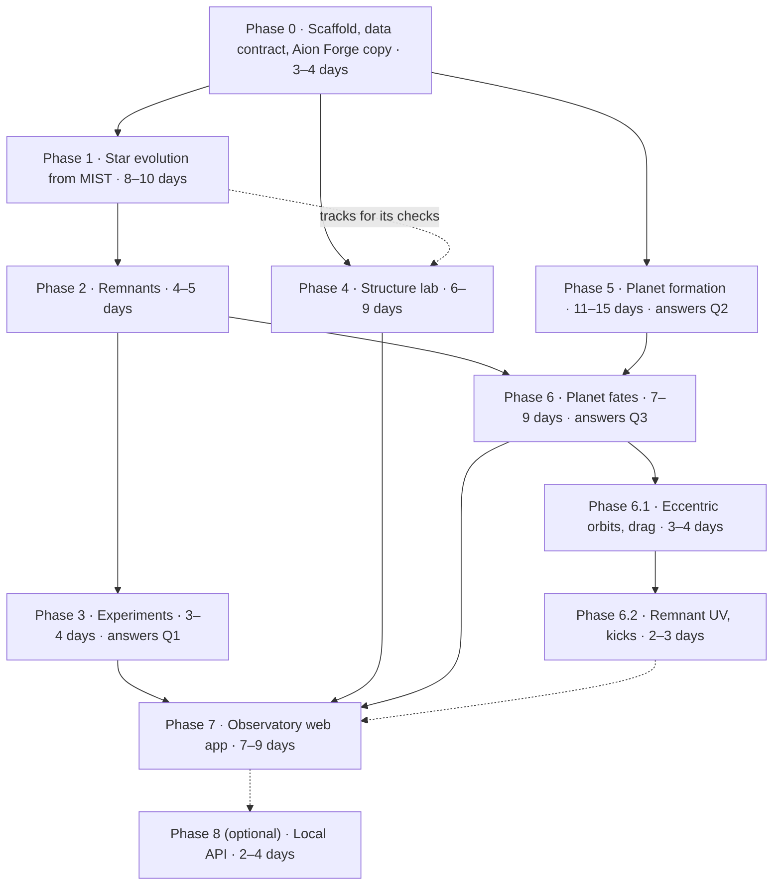
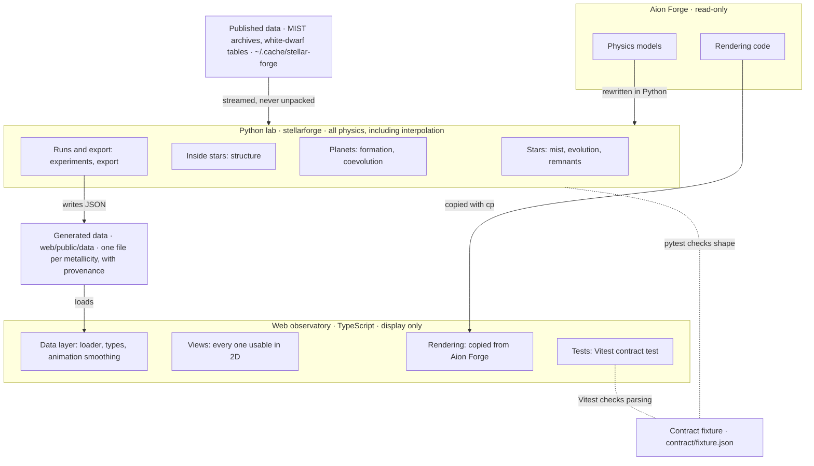

# Stellar-Forge Build Plan

Nov 15, 2026 · @Mayukh · revision 6: Phase 7 revised for stale data, the 3D system view and the prescription toggle

Stellar-Forge is built in nine phases (0–8), entirely on this machine: Python computes every result from published physics, a TypeScript observatory only displays it, and one shared JSON fixture keeps the two in step. The first visible milestone is the Sun's track on an HR diagram in the browser at the end of Phase 1; your questions on lifetimes, remnants and planets are answered by Phases 3, 5 and 6. Every reference and 57 specific claims were checked against their sources on 6 November 2026 — see [Source checks](Source%20checks.md).

## Revision history

**Revision 6 — Phase 7 revised (15 November 2026)**

- **Data freshness:** `make all-data`, `make data-status` and a start-up banner, after 55 data files were found on old schema versions.
- **3D system view:** built in Phase 7 on the copied Aion Forge view, after Phase 6.1's eccentric orbits.
- **Prescription toggle:** needs both Fryer prescriptions exported per track, a contract change.
- **Clean-up:** the provisional `aionStubs.ts` types go, and copied files no view uses are removed.
- **Checks:** four Validation rows for Phase 7. Browsers: Chrome 157 (installed now), Firefox 158.
- **Effort:** Phase 7 is 7–9 days; the total is 54–72 working days, up from 52–70.

**Revision 5 — Phase 6 phase-lets (15 November 2026)**

- **Phase 6.1, eccentric orbits and drag near the giant (3–4 days):** Phase 5's eccentricities are exported instead of dropped; tides use Mustill & Villaver's eccentric equations; planets are engulfed at pericentre; Schröder & Connon Smith's chromospheric drag is added.
- **Phase 6.2, after the giant (2–3 days):** the hot post-AGB star and the white dwarf add their ultraviolet; timelines continue along Phase 2's Bédard et al. cooling sequences; core collapse uses eccentric orbits and Hobbs et al. kicks, shown in a new massive-star reference case.
- **Why:** these four effects were left out when Phase 6 was built; [Phase 6 physics gaps plan](Phase%206%20physics%20gaps%20plan.md) says what each changes and how it is checked.
- **Effort:** 52–70 working days, up from 47–63.
- **Sources:** Ostriker 1999, Villaver & Livio 2007 and Duncan & Lissauer 1998 are added to the references and were checked in Source checks on 15 November 2026 (Duncan & Lissauer through Mustill & Villaver only; Villaver & Livio's target is reworded by planet mass).

**Revision 4 — MIST coverage from the downloaded archives (11 November 2026)**

- **Dataset:** MIST v1.2 is chosen over v2.5 (rotating, [α/Fe] = 0, 15 metallicities); see `documentation/data/MIST version comparison.md`.
- **Coverage:** the released v1.2 archives go further than Choi et al. 2016 describes. At [Fe/H] −3.0 many tracks reach the white dwarf or carbon burning, and at [Fe/H] 0 stars of 0.65–0.7 M☉ evolve past the main sequence. Endings vary track by track at every metallicity, so the plan now reads each track's ending from the inventory instead of assuming it from mass and metallicity.
- **EEP 808:** marks the start of the thermally pulsing AGB on `low-mass` tracks and the end of carbon burning on `high-mass` ones; the safeguards now say so.

**Revision 3 — consistency fixes before implementation (6 November 2026)**

- **Solar System validation:** Phase 6 now lists each planet's expected outcome. Mercury, Venus and Earth are engulfed. Mars is borderline, and either outcome passes if the model reports what decided it. Jupiter and beyond survive on orbits widened 1.76–1.84×.
- **Pair instability:** the gap's lower edge (about 45 M☉) is applied at every metallicity. Phase 3 reports, as its own result, which stars reach the gap.
- **Phase 4:** the required Sun-like solver (the gate) is separate from the 1–20 M☉ extension, a goal whose results are reported.
- **Planet classes:** one ordered rule set uses envelope fraction, mass, core composition and formation location, so no two classes overlap.
- **Atmospheres:** the empirical cosmic shoreline (a kept-or-lost label) is separate from the time-dependent escape calculation that strips hydrogen–helium envelopes.
- **MIST:** v1.2 stays the starting dataset; Phase 1 compares it with v2.5 before the dataset format is fixed.
- **Effort:** 47–63 working days, up from 45–61 (Phase 1 +1 day for the comparison, Phase 6 +1 day for the escape calculation).
- **Source checks:** 7 claims added (57 in all); the shoreline verdict moved from Confirmed to Refined; a new column shows what the plan now says for each claim.

**Revision 2 — source checks and the outside review (6 November 2026)**

- **Source checks:** all 56 references match their published records. Of 50 claims, 32 held, 11 were tightened and 6 were corrected:
    - MIST v1.2 evolves stars to the end only for [Fe/H] ≥ −2.0; below that, tracks stop after core helium burning.
    - MIST stops stars of 0.7 M☉ and below at the end of the main sequence.
    - MIST v2.5 was released in February 2026 and is now an open question.
    - Earth is engulfed when the Sun is a red giant.
    - The pair-instability gap's lower edge barely depends on metallicity.
    - Neutron-star masses are now checked against measurements, not against Fryer's convention.
- **Outside review applied:**
    - Python owns all scientific interpolation; web sliders snap to an exported grid.
    - The data contract carries units and provenance, and every result is labelled by where it came from.
    - Phase 4 is split into milestones, and Phase 1 starts with a MIST coverage report.
    - Remnant records keep both prescriptions; planet results are labelled by calibration range.
    - Checks are sorted into three kinds; the observatory gains a provenance panel and a prescription toggle.
- **Workflow:** Claude may commit and push, asking you first each time. Docs and downloaded references live in `documentation/`; downloaded material stays out of Git.
- **Effort:** now 45–61 working days, up from 40–57.

## At a glance



Q1 = lifetimes and remnants against mass and metallicity · Q2 = how many planets form, of which types · Q3 = what happens to them as the star ages.

Phases 1, 4 and 5 can each start once Phase 0 is done; Phase 4's final checks wait for Phase 1, and Phase 6 waits for Phases 2 and 5; the phase-lets 6.1 and 6.2 follow Phase 6 in order. The 54–72 days leave out the optional Phase 8. They are focused-effort estimates, not deadlines: Phase 0's benchmark resets them, and validation is never cut to meet them.

## Ground rules

Seven rules hold in every phase; a change that breaks one is rejected in review.

1. **Published physics, not a full stellar code.** Every model names the paper or dataset it implements, its claims are checked against that source (see [Source checks](Source%20checks.md)), and every phase passes its validation checks.
2. **Python owns all physics, including interpolation.** TypeScript never contains a physical formula and never blends two tracks: sliders snap to the grid Python exported, and TypeScript only smooths animation along one exported track. It also draws axes and scales and runs camera, animation and shader maths. Luminosity, radius, colour, orbits, habitable zones and horizon radii all arrive in the JSON.
3. **One shared JSON contract, with units and provenance.** `contract/fixture.json` is checked by a pytest test and a Vitest test, and both sides assert the same `schema_version`. Field names carry their units, and every export carries the `meta` block described in Data contract and provenance. A format change on either side fails a test until both sides are updated.
4. **Aion Forge is read-only.** Only read-only commands touch its folder: reading files, `git rev-parse` and checksums. Nothing that writes ever runs there — no npm, builds, tests, formatters or git writes. Files are copied out with `cp`, and checksum manifests taken before and after must match.
5. **Everything runs on this machine.** No phase needs cloud compute, and one local command runs every check. A GitHub Actions run of the fast tests is optional, never required.
6. **Every result says where it came from.** Each value is labelled as a published input (a MIST track point), interpolated, derived by Stellar-Forge, or a model prediction, with its validity flags. The observatory shows that label next to the value.
7. **Git: commits and pushes need your yes.** Claude may commit and push, but asks you first every time.

## This machine

This is a 4-core desktop with 15 GiB of RAM, 44 GB of free SSD space and a 2009-era GPU. CPU and memory are enough for every phase; disk space and the GPU shape the plan.

| Part | What you have | What it means for Stellar-Forge |
| --- | --- | --- |
| CPU | Intel Core i3-10105F: 4 cores, 8 threads, up to 4.4 GHz, AVX2 and FMA | NumPy and SciPy run well; parallel jobs use at most 4 worker processes |
| Memory | 15 GiB RAM, 7.2 GiB available when checked; 2 GiB swap | Each job stays under 4 GiB; nothing relies on swap |
| SSD | 256 GB NVMe, 44 GB free (81% used) | All working data must fit in about 5 GB |
| External HDD | 2 TB WD Elements, NTFS, mounted under another account (lawsikho) | This account cannot read it, so the plan does not depend on it |
| GPU | NVIDIA GeForce G210, 1 GB, open-source nouveau driver; WebGL 2 works through ANGLE on OpenGL 3.3 | 3D views stay light, and every core view also works in 2D |
| System | Ubuntu 22.04.5 LTS, kernel 6.8, desktop (no battery) | Long background runs are safe |
| Python | 3.10.12 with NumPy 2.0.1, SciPy 1.15.3, pandas 2.3.3, Matplotlib 3.9.1 | 3.10 reached end of life in October 2026, so the project gets its own Python 3.12 environment |
| Node | Node 22.14.0, npm 11.6.1 | Recent enough for the Vite, React and Three.js stack copied from Aion Forge |
| Other tools | gcc 11.4, make, git 2.34, gh 2.102, Docker 29.8, pdftotext; no gfortran, no uv | uv is installed in Phase 0; gfortran is not needed because MESA is out of scope |
| Browsers | Chrome 157, Firefox 158 | The web app is tested in both |
| Network | MIST data server reachable; one archive per metallicity, 76–107 MB each as MIST lists them | The rotating v1.2 grid is about 1.5 GB to download |

Checked on 6 November 2026 with `lscpu`, `free`, `df`, `lsblk`, `lspci`, a WebGL probe and size-only requests to the MIST server.

## Machine budget

Every phase fits this machine if raw data is streamed instead of unpacked, jobs use at most four processes, and 3D stays light.

| Resource | Budget | How the plan stays inside it |
| --- | --- | --- |
| SSD space | about 5 GB for the whole project | MIST archives (about 1.5 GB) are read straight from their compressed files; processed grids about 0.4 GB; web data about 150 MB; reference papers about 25 MB; results capped at 1 GB |
| Memory | under 4 GiB per job | MIST is converted one metallicity at a time; the processed grid for all 15 metallicities is about 0.4 GB as float32 |
| CPU | 4 worker processes | Each worker pins its maths library to 1 thread (`OMP_NUM_THREADS=1`) so workers do not fight over cores |
| GPU | light 3D only | Pixel ratio 1, redraw only on change, lowest shader quality by default, a 2D version of every view |
| Time | no single job over about 40 minutes | Long jobs run in the background, save progress per metallicity or grid cell, and resume after a stop |

| Job | Size | Estimated time on this CPU |
| --- | --- | --- |
| Download MIST | 15 archives, about 1.5 GB | depends on your connection; resumable |
| Convert MIST to compact grids | 15 metallicities | measured: 9.5 s per archive, about 2 min for all 15 on one process; 143 MB of grids |
| Build one star's track | 1 mass and metallicity | under 50 ms |
| Export the web track grid | 201 masses × 46 metallicities | measured: 8 s on 4 workers; 2.8 MB per metallicity, 129 MB in all (ages unrounded) |
| Lifetime and remnant sweep | 200 masses × 46 metallicities | measured: about 3 s on 4 workers; all six experiments about 10 s |
| Solve one zero-age main-sequence model | 1 star | 1–10 s |
| Planet population grid | 5,000 systems in each of 120 cells | 10–40 min on 4 workers |
| Export everything for the web | all phases | under 5 min |

**Measured on this machine (11 November 2026, `make bench`, one thread):**

| Measurement | Result | What it changes |
| --- | --- | --- |
| Blend two 1,500-point, 20-column tracks | 0.1 ms | building one star's track is far inside its 50 ms estimate |
| `np.interp`, 200,000 points | 12 ms | resampling tracks is not a bottleneck |
| Matrix product, 1,500 × 1,500 | 118 ms | — |
| xz decompression of table-like text | 74 MB/s of text out, 30 MB/s of archive in | decompressing all 1.5 GB of MIST archives takes about a minute; parsing the text will set the conversion time |

The decompression test uses synthetic text, so its rate is a guide. The other times in the table above are still estimates: each phase measures its own job when the job exists, and Phase 1 times one real MIST archive before converting the rest.

**Out of scope on this machine** — each is replaced by a published model or a light visual (rule 1):

- running MESA or any full stellar-evolution code
- N-body integration of whole planetary systems over billions of years
- hydrodynamic simulations of disks or supernovae
- full-resolution ray-traced 3D effects

## Architecture



Python computes every number once and writes it to JSON with its provenance; the web app only loads and draws it. Aion Forge feeds both sides through copies and rewrites, and is never written to.

## Repository layout and toolchain

Stellar-Forge is one Git repository: a Python package for the physics, a `web/` app for display, a `contract/` folder that both sides test against, and `documentation/` for every document.

```
Stellar-Forge/
├── stellarforge/            Python: all physics
│   ├── mist.py              read MIST archives into compact grids; coverage report
│   ├── evolution.py         star tracks for any mass and metallicity (EEP interpolation)
│   ├── remnants.py          white dwarfs, neutron stars, black holes
│   ├── structure.py         polytropes and the zero-age main-sequence solver
│   ├── imf.py binary.py activity.py colour.py   ported from Aion Forge
│   ├── planets/             disk, growth, migration, population, classify,
│   │                        coevolution, shoreline, escape, mass_radius
│   ├── experiments.py       mass × metallicity sweeps (command line)
│   └── export.py            writes contract-shaped JSON with provenance
├── contract/
│   ├── fixture.json         the one shared fixture
│   └── README.md            every field, with units
├── tests/                   pytest; never needs the MIST download
├── scripts/                 fetch_mist.py, bench.py
├── web/                     Vite + React + TypeScript + Three.js
│   ├── src/rendering/       copied from Aion Forge, adapted
│   ├── src/data/            loader, types, animation smoothing (no science)
│   ├── src/views/           one folder per view
│   └── public/data/         generated JSON (not committed)
├── results/                 experiment outputs (not committed)
├── documentation/           every document
│   ├── Stellar-Forge Build Plan.md
│   ├── Source checks.md
│   ├── data/                generated dataset reports, such as the MIST coverage and version-comparison reports
│   └── references/          downloaded papers, web pages and metadata (kept out of Git); index and check scripts
├── PROVENANCE.md            every file taken from Aion Forge
├── CLAUDE.md                the ground rules, for future sessions
├── Makefile
└── pyproject.toml
```

Reference material lives in `documentation/references/`. Bulk model data (MIST archives, white-dwarf tables) lives in `~/.cache/stellar-forge/`, so Git never holds gigabytes.

| Tool | Version | Used for |
| --- | --- | --- |
| Python (installed with uv) | 3.12 | the `stellarforge` package, in `.venv/` |
| NumPy, SciPy, pandas, Matplotlib | current releases, pinned in `pyproject.toml` | arrays, ODE solving, MIST parsing, publication figures |
| pytest, ruff | current releases | tests and linting |
| Node, npm | 22.14, 11.6 (already installed) | the web app |
| Vite, React, TypeScript, Three.js, Vitest, ESLint | the versions in Aion Forge's `package.json` | build, interface, 3D, tests |
| FastAPI, uvicorn | added only in Phase 8 | the optional local API |

| Command | What it does |
| --- | --- |
| `make setup` | creates `.venv` and installs the Python and npm packages |
| `make data` | downloads MIST (resumable) and builds the compact grids |
| `make export` | writes all web JSON into `web/public/data/` |
| `make check` | ruff, pytest, TypeScript compile, ESLint and Vitest; must pass before every commit |
| `make dev` | starts the web app on `localhost` |

Each phase gets its own branch, merged into `development` once its "Done when" is met. Claude commits and pushes only after asking you. The remote is `IronMax-Hub/Stellar-Forge` on GitHub, and it is public.

## Data contract and provenance

Every export carries a `meta` block, so any result can be reproduced and read correctly without this plan.

| `meta` field | Example | Why it is there |
| --- | --- | --- |
| `schema_version` | `1` | both contract tests compare it |
| `generator` | `stellarforge 0.1.0`, git commit | the exact code that made the file |
| `dataset` | `MIST v1.2, v/vcrit = 0.4, Asplund 2009 abundances` | which published data the numbers came from, including its abundance scale |
| `models` | `{"remnant": "fryer2012-delayed", "ifmr": "cummings2018-mist"}` | which prescription produced each result |
| `inputs` | `{"mass_msun": 1.0, "feh": 0.0}` | the run's parameters |
| `seed` | `12345`, or `null` | random draws repeat exactly |
| `created` | `2026-11-06T12:00:00Z` | when it was made |
| `references` | DOIs of the sources used | every number traces to a paper |

- **Units in names:** fields end in their unit (`_msun`, `_lsun`, `_rsun`, `_k`, `_yr`, `_au`, `_mearth`), and logs start with `log_`. There is no bare `mass`, `age` or `temperature`.
- **Provenance per value:** each value or track says whether it is published, interpolated, substituted (the nearest track stands in), derived or predicted (rule 6).
- **Validity flags:** these are warnings, never silent fixes. Examples: `near_grid_boundary`, `nearest_track_used`, `track_ends_after_core_he_burning`, `outside_calibration_range`.
- **Uncertainty:** where a model gives ranges or alternatives, the export keeps them, such as both remnant prescriptions, instead of one number.

## Phase 0 — Scaffold, data contract and the Aion Forge copy

**Goal:** an empty but working project in which `make check` passes on both stacks and the copied rendering code compiles.

**Steps**

1. Install uv in your home folder and create `.venv` with Python 3.12; the system Python 3.10 stays untouched.
2. Create `pyproject.toml` (NumPy, SciPy, pandas, Matplotlib, pytest, ruff) and the empty `stellarforge` package with `SCHEMA_VERSION = 1`.
3. Create `web/` from Aion Forge's config files, copied with the read-only procedure and then trimmed of Capacitor and Android.
4. Write contract version 1: `contract/fixture.json` with the full `meta` block and a small `track` block whose field names carry units.
5. Add the two contract tests. `tests/test_contract.py` builds a document with `export.py` and compares its shape to the fixture; `web/src/__tests__/contract.test.ts` parses the fixture with the app's own loader and checks every field type.
6. Copy the rendering files with the read-only procedure (see Reuse from Aion Forge). Review each copy for hidden dependencies before accepting it, and record it in `PROVENANCE.md`.
7. Make the copies compile against Stellar-Forge's types, stubbing anything that depends on Aion Forge's world simulation.
8. Add the `Makefile`, extend `.gitignore` (`.venv`, `node_modules`, `web/public/data`, `results`; downloaded reference material is already excluded), and write a project `CLAUDE.md` holding the ground rules.
9. Run `scripts/bench.py` to measure NumPy speed and xz decompression here, and replace the estimates in Machine budget.
10. Turn the verified references into `stellarforge/references.json` (key, citation, DOI), which the exporter uses for `meta.references`.

**How the contract test works:** pytest checks shape, not values — the same keys, value types and consistent array lengths. Physics values are checked by separate numerical and scientific tests (see Validation), so improving a model never breaks the contract. Each later phase adds its block to the fixture and raises `schema_version` by one.

**Delivers:** an empty web app showing one test star coloured from the fixture's `rgb`, both test suites, `PROVENANCE.md`, `CLAUDE.md` and `references.json`.

**Machine cost:** about 0.5 GB for `node_modules` and `.venv`; minutes of compute.

**Done when:** `make check` passes, `make dev` shows the test star, and the Aion Forge checksum manifest is unchanged.

**Effort:** 3–4 days.

## Phase 1 — Star evolution from MIST tracks

**Goal:** the life of any star from 0.1 to 300 M☉ and [Fe/H] −4.0 to +0.5, as far as its MIST track goes, shown on an HR diagram in the browser.

**Published basis:** the MIST v1.2 evolutionary tracks (Choi et al. 2016; Dotter 2016), computed with the MESA code. A MIST track is a result of that published model, which Stellar-Forge processes and presents; it is not a new first-principles calculation. Coverage, as described by Choi et al. 2016 and as found in the released archives (`documentation/data/MIST coverage.md`):

| Part of the grid | Choi et al. 2016 | The released v1.2 archives |
| --- | --- | --- |
| [Fe/H] −2.0 to +0.5 (11 metallicities) | to the end of the main sequence, the white-dwarf cooling sequence or the end of carbon burning, by mass | mostly so: of 196 tracks, 137–168 reach the white dwarf or the end of carbon burning and 18 stop at the end of the main sequence; 10–41 stop early elsewhere (10–14 from −1.75 to 0, 29 at −2.0, 23 at +0.25, 41 at +0.5) |
| [Fe/H] −4.0 to −2.5 (4 metallicities) | to the end of core helium burning | further: 74–92 of 196 tracks reach the white dwarf or the end of carbon burning, 18 stop at the end of the main sequence and 86–104 stop early elsewhere; endings are irregular from one mass to the next |
| Stars of 0.7 M☉ and below | stopped at the end of the main sequence, which takes over 35 Gyr at 0.7 M☉ | at [Fe/H] 0, only stars up to 0.55 M☉ stop there; 0.6–0.7 M☉ evolve further |
| Rotation | v/vcrit = 0.4 by default; a non-rotating set is also released | as described |

Because endings vary track by track, every rule below reads a track's ending from the inventory; none assumes it from mass or metallicity.

**Dataset decision.** v1.2 is the initial implementation candidate, but the dataset format (processed-grid layout, grid axes and contract fields) is fixed only after Phase 1 compares it with MIST v2.5. v2.5 was released on 24 February 2026 (Dotter et al. 2026, in press); the MIST site says it adopts the GS98 abundance pattern, covers the full [Fe/H] range and adds a range of [α/Fe] values.

**Decided 11 November 2026: v1.2** (rotating, [α/Fe] = 0, 15 metallicities). The reasons are in `documentation/data/MIST version comparison.md`.

**Steps**

1. `scripts/fetch_mist.py` downloads one archive into `~/.cache/stellar-forge/mist/` first, resuming after interruptions and checking its size.
2. `python -m stellarforge.mist inventory` writes `documentation/data/MIST coverage.md`. For each metallicity it lists the masses present, EEP counts, how each track ends, and the column names and units read from the header.
3. Compare v1.2 with v2.5 before fixing the dataset format. Check v2.5's download sizes first; if they fit the disk budget, fetch one solar-metallicity and one [Fe/H] −3.0 archive ([α/Fe] = 0, rotating). Write `documentation/data/MIST version comparison.md` covering:
    - mass and metallicity coverage, and how tracks end below [Fe/H] −2.0;
    - EEP definitions, column names and units;
    - the abundance scale: Asplund 2009 against GS98, so the same [Fe/H] label means a different Z;
    - the extra [α/Fe] axis and the rotation sets;
    - total download size against the 5 GB budget, and citation status.

    v1.2 stays the default unless you choose v2.5 from this comparison. Until then, `mist.py` reads columns by name through a small per-version column map, so neither version is hard-wired.
4. Convert the first v1.2 archive and time it, then fetch and convert the rest of the chosen version. Each archive is read in place with Python's `tarfile` module, never unpacked. About 20 columns are kept as float32 — age, current mass, log L, log Teff, log R, log g, helium and carbon–oxygen core masses, central hydrogen and helium, central temperature and density, and MIST's `phase` label — in one `.npz` file per metallicity.
5. `stellarforge/evolution.py` builds a track for any mass and metallicity by interpolating at the same equivalent evolutionary phase (EEP), in log mass and [Fe/H]. Safeguards:
    - interpolate only inside a documented valid grid cell, where all four corner tracks exist and share the EEPs needed;
    - never blend tracks that end differently: white-dwarf cooling, carbon burning, or stopped early at any primary EEP. A track's ending is its last primary EEP, read from its header; EEP 808 is the end of carbon burning on `high-mass` tracks but only the start of the thermally pulsing AGB on `low-mass` ones;
    - treat missing grid points explicitly and refuse to extrapolate;
    - near a boundary, use the nearest valid track with a flag rather than an invalid blend;
    - record the method (grid track, EEP interpolation or nearest track) and its validity flags on every exported track; a nearest track is labelled `substituted`, not `published`, its method names the track and its distance in log mass and [Fe/H], and the remnant inherits that track's label for its inputs.
6. It exposes `Star(mass, feh)` with `.track()`, `.at(age)` and `.phases()`. Phases follow MIST's labels: pre-main sequence, main sequence, red giant branch, core helium burning, early and thermally pulsing AGB, post-AGB and Wolf–Rayet.
7. `export.py` writes the web grid, computed in Python: 200 log-spaced masses × 46 metallicities ([Fe/H] −4.0 to +0.5 in 0.1 dex steps). Each track has 150–250 points including every primary EEP, values rounded to 4–5 significant digits, unit-suffixed fields, `rgb` for display and its provenance. That is about 2–3 MB per metallicity file.
8. Web view **Star Builder**:
    - mass and [Fe/H] sliders that snap to the exported grid values;
    - an age scrubber that smooths animation between neighbouring points of one track (display only);
    - an SVG HR diagram, a star sphere coloured by `rgb` and sized by radius, and a phase timeline;
    - a numbers panel that shows each value's provenance label.

**Checks** (numbers in Validation): the Sun at 4.57 Gyr; leave-one-out interpolation accuracy; the coverage report agreeing with Choi et al. 2016; metallicity trends at fixed mass.

**Known limits:** some v1.2 tracks stop before a final phase (white dwarf or end of carbon burning) — most often below [Fe/H] −2.0, but at every metallicity. Their remnants and later phases are not shown, and each is labelled with where its track stops. The lowest-mass stars stop at the end of the main sequence, which they have not reached in the universe's 13.8 Gyr.

**Machine cost:** a 1.5 GB download, plus two v2.5 test archives if their sizes fit; 15–40 minutes of one-time conversion; under 1 GB of RAM at a time; about 150 MB of web data.

**Done when:** the Sun check passes, the coverage report and the v1.2–v2.5 comparison are written, the dataset choice is recorded, leave-one-out errors are reported, and Star Builder responds in under 50 ms per slider move.

**Effort:** 8–10 days.

## Phase 2 — Remnants: white dwarfs, neutron stars, black holes, pair instability

**Goal:** the final remnant — its type, mass and basic properties — for every grid star whose track reaches its end, with the prescription and its limits visible.

| How the star ends (read from its track) | Remnant | Rule implemented | Source |
| --- | --- | --- | --- |
| Track reaches the white-dwarf cooling sequence | White dwarf | Final core mass from the MIST track, checked against the MIST-based initial–final mass relation (0.080 Mi + 0.489 M☉ for 0.83–2.85 M☉; scatter 0.06 M☉) | Cummings et al. 2018 |
| Super-AGB window, 9.0–9.25 M☉ in the fiducial model | Neutron star from an electron-capture supernova | Optional; the window moves with mixing and mass-loss assumptions | Poelarends et al. 2008 |
| Track ends at carbon burning | Neutron star or black hole | "Rapid" and "delayed" prescriptions from carbon–oxygen core mass and final mass, both kept; neutron star below Fryer's 2.5 M☉ dividing line | Fryer et al. 2012 |
| Helium core of about 40–65 M☉ (thresholds differ between papers) | Black hole capped near 45 M☉ (40.5 M☉ in Belczynski et al.; 40–56 M☉ across Farmer et al.'s uncertainties) | Pulsations shed the excess mass | Heger & Woosley 2002; Woosley 2017; Belczynski et al. 2016; Farmer et al. 2019 |
| Helium core of 64–133 M☉ | None: the star is destroyed | Pair-instability supernova | Heger & Woosley 2002 |
| Helium core above 133 M☉ | Black hole by direct collapse | The whole star collapses | Heger & Woosley 2002 |
| Track stops at the end of the main sequence (the lowest masses) | None yet | Labelled "still on the main sequence" | Choi et al. 2016 |
| Track stops early at any other point (any metallicity in v1.2) | Not predicted | Labelled "track incomplete" with where it stops; no remnant shown | `MIST coverage.md` |

Every threshold is a named constant in `remnants.py`, with its citation in a comment.

**What every remnant record carries:**

- type and mass;
- the adopted prescription and the alternative prescription's result;
- the initial mass and metallicity;
- validity flags and known limitations.

The record also says it assumes a single star. Most massive stars interact with a companion (Sana et al. 2012), so binary channels are not covered, and no remnant mass is presented as uniquely determined by the initial mass.

**Steps**

1. `remnants.py` takes the track's last state (final mass, helium and carbon–oxygen core masses, how the track ends) and returns the record above.
2. White-dwarf cooling uses the published cooling tracks of Bédard et al. 2020 — luminosity and temperature against cooling age for each white-dwarf mass — downloaded once into `~/.cache/stellar-forge/`.
3. Neutron stars get a fixed 12 km radius, inside the measured range of about 10–13 km (Özel & Freire 2016; NICER: Riley et al. 2019, Miller et al. 2019). Black holes get their horizon radius computed in Python and exported, so the web never computes it.
4. Export adds a `remnant` block to the contract (schema version 2) and a remnant table per metallicity.
5. Web view **Remnants**:
    - a card per remnant telling how it formed and which prescription produced it;
    - white-dwarf cooling drawn on the HR diagram;
    - the copied black-hole lensing view at its lowest quality.

**Checks** (numbers in Validation): initial–final masses at solar metallicity; neutron-star masses within the measured range; the lower edge of the pair-instability gap.

**Machine cost:** negligible compute; a few MB of tables.

**Done when:** every grid star has a remnant record (or a labelled reason it has none), the checks pass, and the Remnants view works.

**Built 11 November 2026:**

- MIST v1.2 leaves the CO-core mass (or the helium-core mass) at zero on 3–16 carbon-burning tracks per metallicity below solar, though their centres are helium-free. Those endings are kept apart: they never blend with complete tracks, and their remnant is "not predicted" unless the helium core alone decides it (45 M☉ and above).
- The core-collapse rules are applied at the end of carbon burning, where MIST stops, not at core collapse; every such record carries `final_state_at_end_of_carbon_burning`.
- The Remnants view sits under Star Builder on the same page: a card per remnant, the white dwarf's cooling track dashed on the HR diagram, and the black-hole lensing view at its lowest quality, built once and drawn only when the camera moves.

**Effort:** 4–5 days.

## Phase 3 — Experiment runner: lifetimes and remnants across mass × metallicity

**Goal:** answer your first question — how lifetimes and final remnants change with mass and metallicity — with runs anyone can repeat exactly.

| Experiment | Grid | Output |
| --- | --- | --- |
| Main-sequence lifetime map | 200 masses (0.1–300 M☉, log-spaced) × 46 metallicities ([Fe/H] −4.0 to +0.5, step 0.1) | heatmap of main-sequence lifetime |
| Full-life map | 200 masses × 46 metallicities with v1.2; cells without a complete track are shown as "track incomplete" | heatmap of total lifetime |
| Remnant map | the full-life grid, both Fryer variants | a type map: white dwarf, neutron star, black hole, no remnant, still on the main sequence |
| Remnant mass curves | 200 masses × 5 metallicities | final mass against initial mass, both prescriptions |
| Population outcome | Kroupa initial mass function, 10⁶ stars per metallicity | share of stars ending as each remnant; core-collapse events per 1,000 M☉ of stars formed |
| The Sun at other metallicities | 1 M☉ at [Fe/H] −2, −1, 0 and +0.3 | lifetime, colour and remnant side by side |

**Steps**

1. `experiments.py` exposes each experiment as a command, for example `python -m stellarforge.experiments lifetime-map --feh=-4:0.5:0.1 --masses=200`.
2. Every run writes `results/<experiment>/<timestamp>/` holding `result.json` (the contract's `experiment` block with its full `meta`), `figure.png` from Matplotlib and `run.json` (git commit, parameters, MIST version, machine benchmark).
3. Random draws, such as IMF sampling, use fixed seeds, so the same command gives byte-identical results.
4. Web view **Experiments**: heatmaps and curves read from the exported results, with values and provenance shown on hover.

**Checks** (numbers in Validation): shorter main-sequence lifetimes at low metallicity; heavier final cores, and so heavier black holes below the gap, at low metallicity, where winds are weaker (Heger et al. 2003); the IMF share of stars born above 8 M☉.

**Pair instability across metallicity:** the lower edge of the black-hole mass gap sits near 45 M☉ and barely depends on metallicity (Farmer et al. 2019), so the same edge is checked at every metallicity. Metallicity changes something else: which initial masses build helium cores big enough to reach the pulsational and pair-instability ranges, because winds are weaker at low metallicity. The remnant map reports that boundary as a Stellar-Forge result; no published target exists for it.

**Machine cost:** each sweep under 2 minutes; results of tens of MB.

**Done when:** all six experiments run from the command line, produce figures and dashboard views, and rerun identically.

**Built 11 November 2026:**

- `make experiments` runs all six in about 10 s on 4 workers (one 200 × 46 sweep is shared); results take under 2 MB and the exported copies 1.3 MB.
- `result.json` takes `meta.created` from the code's commit time so reruns are byte-identical; `run.json` holds the command, parameters, wall-clock time and machine.
- The Experiments view is a second tab beside Star Builder.
- Fixed on the way: a star with no alternative prescription (white dwarf outside Cummings et al.'s range, still on the main sequence, or not predicted) carried an alternative of type `none`, which the rapid remnant map drew as "destroyed"; the alternative now repeats the star's own outcome.
- Fixed on the way: the full-life map showed 756 of its cells as "track incomplete" although their tracks reach the end of carbon burning (only MIST's core mass is missing, which the remnant needs and the lifetime does not). Of the 9,200 cells, 1,632 remain without a total lifetime because their MIST track stops before a final phase — most at the start of the thermally pulsing AGB (666 cells) or at helium ignition (462), mainly below [Fe/H] −2.

**Effort:** 3–4 days.

## Phase 4 — Structure lab: polytropes and a zero-age main-sequence solver

**Goal:** show hydrostatic equilibrium and energy generation from first principles, built in small steps and checked against MIST.

**Part A — polytropes.** Solve the Lane–Emden equation for n = 0 to 5 with SciPy. The cases n = 0, 1 and 5 have exact solutions, which serve as tests.

```latex
\frac{1}{\xi^{2}}\frac{d}{d\xi}\left(\xi^{2}\frac{d\theta}{d\xi}\right) = -\theta^{n}
```

Applied to the Sun, the n = 3 polytrope (Eddington's standard model) gives a central temperature of 1.21 × 10⁷ K, against 1.571 × 10⁷ K in full solar models. That gap becomes a built-in lesson on what simple physics misses.

**Part B — zero-age main-sequence solver.** Four structure equations in the mass coordinate m, with ∇ the temperature gradient (radiative or convective):

```latex
\frac{dr}{dm} = \frac{1}{4\pi r^{2}\rho}, \qquad \frac{dP}{dm} = -\frac{Gm}{4\pi r^{4}}, \qquad \frac{dL}{dm} = \varepsilon, \qquad \frac{dT}{dm} = -\frac{GmT}{4\pi r^{4}P}\nabla
```

| Ingredient | Version 1 | Optional upgrade | Source |
| --- | --- | --- | --- |
| Equation of state | ideal gas plus radiation pressure | — | Kippenhahn, Weigert & Weiss 2012 |
| Opacity | Kramers bound-free and free-free, plus electron scattering | OPAL tables | Iglesias & Rogers 1996 |
| Energy generation | analytic pp-chain and CNO-cycle rates | NACRE rate fits | Angulo et al. 1999 |
| Convection | Schwarzschild criterion; adiabatic gradient in convective zones | — | Kippenhahn, Weigert & Weiss 2012 |
| Composition | uniform; X, Y and Z from [Fe/H] with MIST's helium scaling, Y = 0.249 + 1.5 Z | — | Choi et al. 2016 |

**Required: the Sun-like solver (the phase gate).** Milestones 1–5 run at 1 M☉ and [Fe/H] = 0.0, and each is a checkpoint with its own tests:

1. Analytic Lane–Emden cases (n = 0, 1, 5) match their exact solutions.
2. Numerical polytropes for n = 0 to 5 reproduce the published constants.
3. A simplified Sun-like zero-age model converges (fixed composition, ideal gas, constant opacity).
4. Kramers and electron-scattering opacity and pp and CNO energy generation are added.
5. Convection and the boundary and matching treatment are added. The fitting method integrates out from the centre and in from the surface, matches at half the mass, and solves for central pressure, central temperature, radius and luminosity with `scipy.optimize.root`. Starting guesses come from the MIST zero-age star of the same mass and metallicity.
**Goal, not a gate: the 1–20 M☉ extension.** Milestone 6 runs the same solver at [Fe/H] −1.0, 0.0 and +0.25 (points on the MIST v1.2 grid), first for 0.8–3 M☉ and then up to 20 M☉. It stops where convergence fails and reports the masses reached and each mass's errors against MIST. The pp-against-CNO check needs masses above 1 M☉, so it belongs to this goal.

**Comparison with MIST:**

- **Where:** at MIST's zero-age main-sequence EEP, with the same X, Y and Z.
- **What:** luminosity, radius, central temperature and density, convective-core mass, and the pp and CNO shares.
- **Targets:** listed in Validation, with the gate and the goal in separate rows.

**Steps**

1. `structure.py` implements milestones 1–6 and exports polytrope profiles for n = 0 to 5 in steps of 0.5.
2. Export adds a `profile` block: mass, radius, pressure, temperature, density, luminosity, pp and CNO energy rates, opacity, gradients and a convective flag, all unit-suffixed.
3. Web view **Inside the Star**:
    - profile charts;
    - a cross-section showing convective and radiative zones around the burning core;
    - a polytrope explorer with an n slider that snaps to the exported values.

**Machine cost:** 1–10 s per model; the extension grid (30 masses × 3 metallicities) takes 3–15 minutes on 4 workers.

**Done when:** the gate passes — milestones 1–5 and their numerical and scientific checks at 1 M☉ — and the extension's results are reported, whatever mass range it reaches. Phase 4 is complete without the full 1–20 M☉ range.

**Part A built 14 November 2026:** `stellarforge/structure.py` solves the Lane–Emden equation for any n from 0 to 5 (SciPy DOP853, from the series solution at ξ = 10⁻⁶ to the first zero of θ; n = 5 has no surface and stops at ξ = 50) and scales a polytrope to a star's mass and radius. Milestones 1 and 2 and the Eddington check pass. `python -m stellarforge.export polytropes` (part of `make export`) writes n = 0 to 5 in steps of 0.5 to `polytropes.json` (125 kB) as the contract's `polytropes` block (schema version 6), and the **Inside the Star** tab shows the polytrope explorer: an n slider over the exported values, each model's constants and its scaling to the Sun, its profiles, and every model's density. Part B's `profile` block and the cross-section come with the solver.

**Milestone 3 built 14 November 2026:** `structure.solve_zams` integrates the four equations out from the centre (series expansion) and in from the photosphere (in ln(1 − m/M), photosphere at 1 − m/M = 10⁻¹²), matches at half the mass and solves for P_c, T_c, R and L with `scipy.optimize.root`, starting from the n = 3 polytrope. Physics: uniform composition from Choi et al. 2016's eqs. 1–3 (X 0.7155, Y 0.2703, Z 0.0142 at [Fe/H] 0), ideal gas plus radiation, electron-scattering opacity throughout, radiative transport everywhere, and a power-law pp rate (ε ∝ X² ρ T⁴, a textbook constant not yet source-checked; milestone 4 replaces it). At 1 M☉ it converges in about 11 s (stiff, so Radau) to a mismatch of 6 × 10⁻¹¹: T_c = 2.02 × 10⁷ K, R = 0.55 R☉, L = 8.3 L☉. The star is far too bright because electron scattering alone is much more transparent than the Sun's real opacity, which is the point of milestone 4. The released MIST archive headers give Z_init = 0.014286 at [Fe/H] 0 rather than the paper's 0.0142, so the MIST comparison will read X, Y and Z from each archive.

**Milestones 4 and 5 (physics) built 14 November 2026:** milestone 4 adds Kramers free-free and bound-free opacity to electron scattering, and the analytic pp and CNO rates (Kippenhahn, Weigert & Weiss 2012; coefficients not yet source-checked, see Source checks); milestone 5 adds the Schwarzschild criterion, with ∇_ad including radiation pressure. Radiative transport alone (milestone 4) converges only from a starting guess close to the answer: from the n = 3 polytrope the radiative gradient at the centre is about 12, and the temperature collapses. With convection (milestone 5) the 1 M☉ model converges from a Sun-like guess in about 16 s, and milestone 4 started from that model returns the same star, since no layer of it is convective. **Against MIST it misses the gate** (zero-age EEP 202 of the [Fe/H] 0 grid track: log L −0.127, log R −0.054, log Tc 7.136): log L −0.950 (Δ −0.82 dex), log R +0.068 (Δ +0.12 dex), log Tc 7.028 (Δ −0.11 dex). The likely cause is opacity: with its correction factors at 1, Kramers gives about 11 cm² g⁻¹ at the centre, several times realistic values, and it has no H⁻ opacity, so the model also has no convective envelope. Still to do for milestone 5: starting guesses from MIST, and X, Y, Z from the archive.

**Milestone 5 with tabulated opacities, 14 November 2026:** Kramers misses by 0.8 dex in log L, so milestone 5 takes the plan's opacity upgrade. `stellarforge/opacity.py` reads the tables MIST v1.2 used (Choi et al. 2016, section 3.2.2): OPAL Type I (Iglesias & Rogers 1996) above log T 3.75 and Ferguson et al. 2005 below log T 4.5, both for the Asplund et al. 2009 photospheric mixture, blended over log T 3.80–4.00. They come from MESA's `kap/kap_data.tar.xz` (113 MB, LGPL-3.0, from the MESAHub/mesa repository; `make data` downloads it, checks its SHA-256 and streams the a09 tables once into a 3 MB grid in `~/.cache/stellar-forge/mesa_kap/`). The solver starts from MIST's zero-age star and takes X, Y and Z from the archive header (X 0.71541, Y 0.2703, Z 0.0142857). At 1 M☉, [Fe/H] 0 it converges in about 14 s: **log L −0.129 against MIST's −0.127 (Δ −0.002 dex) and log Tc 7.131 against 7.136 (Δ −0.005 dex) pass the gate; log R +0.117 against −0.054 (Δ +0.17 dex) does not.** The model has no convective envelope, while the Sun's covers about its outer 30% in radius: the equation of state treats the gas as fully ionised everywhere, so near the surface the density is about half what it should be (μ 0.6 instead of about 1.3) and ∇_ad stays at 0.4 instead of dropping in the hydrogen and helium ionisation zones. Reaching the radius target needs ionisation in the equation of state (Kippenhahn, Weigert & Weiss 2012, ch. 14), probably with mixing-length convection near the surface (MIST uses α_MLT = 1.82), which goes beyond this table's version-1 equation of state.

**Milestone 5 with ionisation and mixing-length convection, 14 November 2026 — the gate passes:** two additions beyond the version-1 ingredients above close the radius gap. (1) `stellarforge/eos.py`: hydrogen and helium ionisation by the Saha equation (Kippenhahn, Weigert & Weiss 2012, ch. 14) on a grid of log T and log ρ for the star's composition, with ∇_ad, c_P and δ from the mixture's entropy. Saha ignores pressure ionisation and would leave 28% of the hydrogen neutral at the Sun's centre, so ionisation is blended to complete between log T 6.0 and 6.5 (marked as a shortcut). (2) Mixing-length convection with MIST's α_MLT = 1.82 (Choi et al. 2016, table 1), in the Böhm-Vitense form of KWW 2012, section 7.2; MIST uses Henyey et al. 1965's variant, which differs only where the layer is optically thin. With perfectly efficient convection the gas under the photosphere followed a far too dense adiabat and left the opacity table. **At 1 M☉, [Fe/H] 0, X Y Z from the archive: log L −0.103 against MIST's −0.127 (Δ +0.024 dex), log R −0.037 against −0.054 (Δ +0.017 dex), log Tc 7.1361 against 7.1358 (Δ +0.0003 dex); Teff 5,674 K against 5,707 K.** The model has a radiative core and a convective envelope from 0.747 R (1.8% of the mass) to just below the photosphere. One solve takes about 25 s. The KWW formulae were then checked against open sources (Source checks, 14 Nov 2026): mixing-length theory and the CNO share of Z are confirmed; the Kramers coefficients, the pp rate (within 2%) and the ionisation energies are confirmed with small refinements; the CNO rate's form is confirmed but its coefficient is not (settled in the tidy-up below).

**Profile export and view built 14 November 2026:** `python -m stellarforge.export zams` (part of `make export`, about 35 s) writes `zams.json` with the contract's `profiles` block (schema version 7): the 1 M☉ zero-age model's scalars beside MIST's and their differences, its pp share (99.8%) and the radius inside which 99% of its light is made (0.33 R), and 200-point profiles of r, m, L, T, ρ, P, the pp and CNO rates, opacity, the three gradients and the convective flag. **Inside the Star** now opens with that star: a cross-section of its radiative core, convective envelope and burning core, the comparison table, and charts of structure, gradients, energy generation and opacity, above the polytrope explorer.

**Milestone 6, the 0.8–20 M☉ extension, run 14 November 2026:** `make extension` (`python -m stellarforge.experiments zams-extension --export`, about 17 minutes on 4 workers) solves 30 MIST grid masses from 0.8 to 20 M☉ at [Fe/H] −1.0, 0.0 and +0.25, each with its archive's X, Y and Z and starting from MIST's zero-age star, and shows the results as a seventh tab in **Experiments**. **87 of 90 converge**; 20 M☉ at [Fe/H] −1.0 and 0.8 and 16 M☉ at +0.25 do not, and are reported rather than forced. **82 of the 87 are within the gate tolerances** in all three of log L, log R and log Tc; the misses are the five [Fe/H] +0.25 stars from 1.56 to 3 M☉ (worst Δ log L +0.109 dex, Δ log Tc +0.058 dex), and log R is within 0.06 dex everywhere. The model − MIST curves step at the mass below which MIST's EEP 202 still has a transient convective core (about 1.5–1.7 M☉), where MIST's own zero-age definition changes. MIST's pp, CNO and convective-core values are read after 5% of the central hydrogen has burned: at EEP 202 its lower-mass stars still burn their initial carbon-12 and helium-3 out of equilibrium, with a transient convective core at every mass. Against those, the pp chain and CNO cycle make equal energy at 2.14, 1.86 and 1.79 M☉ in the model and 2.46, 2.13 and 2.06 M☉ in MIST ([Fe/H] −1.0, 0.0, +0.25): the model's CNO is somewhat too strong, consistent with its CNO coefficient being the one formula not yet confirmed. A convective core larger than 2% of the mass appears from 1.06, 1.18 and 1.18 M☉ in the model; from 1.06 and 1.32 M☉ in MIST at [Fe/H] 0 and +0.25, while at −1.0 MIST still carries cores of about 5% of the mass at every mass, so no onset can be read there. **With the gate passed and the extension reported, Phase 4's "Done when" is met.**

**Phase 4 tidy-up, 14 November 2026:** (1) The CNO coefficient is NACRE's: with the standard non-resonant rate and 25.03 MeV kept per cycle it implies S(0) = 3.15 keV b for ¹⁴N(p,γ)¹⁵O, against NACRE's 3.2. LUNA's underground measurement gives 1.7 keV b (Formicola et al. 2004, as quoted by Weiss et al. 2005), and MIST's REACLIB rates follow it, so the rate is now scaled by 1.7/3.15. The 1 M☉ gate is unchanged (Δ log L +0.025, Δ log R +0.017, Δ log Tc +0.0003 dex), as CNO gives that star 0.1% of its energy. (2) A star that fails from MIST's values is retried from its converged neighbours' solutions; this rescued none for good: the one it rescued, 16 M☉ at [Fe/H] +0.25, is the MIST track that stops at EEP 202 (listed in `data/MIST coverage.md`), still contracting there, so it is now labelled and left out of the comparison. **The extension now stands at 87 of 89 comparable stars converged** (not 20 M☉ at −1.0 or 0.8 M☉ at +0.25) **and 84 within the gate tolerances**; the misses are 1.4, 1.56 and 1.74 M☉ at +0.25 (worst Δ log L +0.120, Δ log Tc +0.068 dex). Equal pp and CNO energy now falls at 2.28, 1.95 and 1.88 M☉ against MIST's 2.46, 2.13 and 2.06 (7–9% lower in mass, from 13–15%); a convective core above 2% of the mass appears from 1.06, 1.32 and 1.32 M☉ against MIST's —, 1.06 and 1.32. The remaining CNO gap fits the rest of the difference between the code and MIST: MIST's rate set is newer than Formicola et al. 2004, and the code puts all of C, N and O into the cycle while oxygen barely burns on the zero-age main sequence.

**Effort:** 6–9 days for the gate and as much of the extension as fits; the hardest numerics in the plan, and likely to need iteration.

## Phase 5 — Planet formation: how many planets form, and of which types

**Goal:** answer your second question — how many planets form, of which types, around which stars — as statistics over thousands of simulated systems, labelled by how well the model is calibrated there.

**Published basis:** the semi-analytic population synthesis of Ida & Lin (papers I–VI, 2004–2010). Metallicity enters through the solid material in the disk (Ida & Lin 2004a, eq. 11; 2004b), where f_g is the disk's gas-mass factor and η_ice the boost beyond the snow line:

```latex
\Sigma_{d} = 10\, f_{d}\, \eta_{\rm ice} \left(\frac{a}{1\,{\rm AU}}\right)^{-3/2} {\rm g\,cm^{-2}}, \qquad f_{d} = f_{g}\, 10^{[{\rm Fe/H}]}
```

| Ingredient | Rule | Source |
| --- | --- | --- |
| Gas disk | Σ_g = 75 f_g (r/10 AU)⁻¹ g/cm², a steady α = 10⁻³ disk; log₁₀ f_g,0 Gaussian with σ = 1 about the disk-mass centre, kept within 0.1–10 times it; f_g decays as exp(−t/τ_disk) | Ida, Lin & Nagasawa 2013 (Paper VII); Ida & Lin 2004a, 2008a |
| Disk mass against star mass | both scalings run: roughly linear in M★ (measured, disks at 0.2–0.6% of the star; default) and ∝ M★² (Ida & Lin's standard case) | Andrews et al. 2013; Ida & Lin 2005 |
| Snow line | ice boost η_ice = 4.2 beyond 2.7 (M★/M☉)² AU; later upgrade: 2.7 (L★/L☉)^1/2 AU with MIST luminosity | Ida & Lin 2004a, 2005 |
| Disk lifetime | gas depletion time drawn between 1 and 10 Myr; disk fractions fall with an e-folding time of about 2.5 Myr | Ida & Lin 2004a; Mamajek 2009 |
| Embryos | 15 seeds per disk, log-uniform in 0.05–50 AU at 10²⁰ g, each standing for its annulus; a next-generation seed starts where a seed has migrated to half its starting radius | Ida & Lin 2008a, 2010 |
| Core growth | oligarchic growth, τ_c,acc ∝ M_c^1/3 (Paper VII eq. 19), up to the isolation mass and the annulus's own solids | Kokubo & Ida 2002; Ida, Lin & Nagasawa 2013; Ida & Lin 2004a |
| Gas capture | once the core passes M_c,hydro ≃ 10 (Ṁ_c/10⁻⁶ M⊕ yr⁻¹)^¼ M⊕, dM/dt = f_gap min(M/τ_KH, Ṁ_disk), τ_KH = 10⁹ (M/M⊕)⁻³ yr, tapered from the viscous gap mass to the thermal one | Ikoma et al. 2000; Ida, Lin & Nagasawa 2013 |
| Migration | type I scaled by C1 = 0.1 (Paper VII's fiducial); type II from the viscous gap mass, disk- or planet-dominated, inward inside r_m = (τ_dep / 7 × 10⁴ yr)(α/10⁻³)(M★/M☉)^1/2 exp(2t/3τ_dep) AU (derived from Paper VII eqs. 32–33 and 2004a's eqs. 66–67; scientific audit); resonant convoys park outward from 0.04 AU | Ida, Lin & Nagasawa 2013; Ida & Lin 2004a, 2010 |
| Multiplicity | version 2: after the gas, the oligarchs of each annulus merge, and neighbours cross orbits, scatter and merge, to 1 Gyr | Ida & Lin 2004a, 2010 |

**Planet classes.** Each planet is classified from four model outputs:

- **Total mass** M_p.
- **Envelope fraction** f_env = M_env / M_p, the share of the mass in the hydrogen–helium envelope. It comes from the model's gas accretion: envelopes grow only once a planet passes the critical mass, on a Kelvin–Helmholtz timescale taken from Ikoma et al. 2000 (Ida & Lin 2004a, eqs. 28–29).
- **Core composition:** ice-rich if the core grew beyond the snow line, where η_ice = 4.2; rock-dominated if it grew inside.
- **Formation location:** the orbit where the core grew, compared with the snow line at that time.

The rules run in order and the first match wins, so every planet gets exactly one class:

| Order | Class | Rule |
| --- | --- | --- |
| 1 | Gas giant | f_env ≥ 0.5 |
| 2 | Ice giant | 0.01 ≤ f_env < 0.5, M_p ≥ 10 M⊕ and an ice-rich core |
| 3 | Sub-Neptune | 0.01 ≤ f_env < 0.5, M_p ≥ 2 M⊕, and not an ice giant |
| 4 | Super-Earth | f_env < 0.01 and M_p ≥ 2 M⊕ |
| 5 | Terrestrial | f_env < 0.5 and M_p < 2 M⊕ (a thin envelope on so small a body is left for Phase 6's escape calculation; scientific audit, 14 Nov 2026) |

- **Thresholds** are named constants and Stellar-Forge choices, varied in the sensitivity runs:
    - 2 M⊕ is Chen & Kipping's (2017) break between solid and Neptunian worlds.
    - 0.01 sits below the few-percent envelope that already doubles a small planet's radius (Owen & Wu 2017).
    - 0.5 means the envelope outweighs everything else.
    - 10 M⊕ keeps small icy planets out of the ice-giant class; Uranus and Neptune are about 15 and 17 M⊕.
- **Composition and location are always reported,** so a super-Earth that grew beyond the snow line appears as an ice-rich super-Earth.
- **Classes are re-evaluated in Phase 6** after every event, with the same rules: a sub-Neptune stripped below 1% envelope becomes a super-Earth. Exports keep both the class at formation and the current class.
- **Radius does not enter the classification.** Display radii come from the mass–radius relation ported from Aion Forge (the Chen & Kipping 2017 fit). Comparisons with radius-based surveys, such as Petigura et al. 2018, use those radii and say so.

**Calibration labels.** Every cell and result is labelled as one of:

- **Observational constraint:** survey data used as a check, never as model output.
- **Prediction inside the calibration range:** star masses 0.2–1.5 M☉ (the range Ida & Lin 2005 studied) and [Fe/H] −0.5 to +0.5 (where surveys constrain occurrence).
- **Parameter-sensitive:** a conclusion that changes within the sensitivity runs.
- **Extrapolation:** anything outside the calibration range.

**Steps**

1. Write `planets/disk.py`, `growth.py`, `migration.py`, `population.py` and `classify.py`, with one cited function per ingredient.
2. Vectorise with NumPy: arrays of systems × embryos, stepped in log time from 0.1 Myr until the gas disk is gone.
3. Run the default grid: 8 star masses (0.2–1.5 M☉) × 15 metallicities ([Fe/H] −4.0 to +0.5), 5,000 systems per cell, with a fixed seed per cell. Stars of 1.5–3 M☉ run only if you choose the wider range, labelled as extrapolation.
4. Run sensitivity checks: repeat key cells with C1, disk lifetime, disk-mass spread and the disk-mass scaling varied, and report which conclusions hold. Show results as ranges or distributions where a single number would hide that spread.
5. Record the full parameter set in every result's `meta`, and export per-cell statistics plus 200 sample systems per cell (the contract's `population` and `system` blocks). Each planet carries its class, envelope fraction, core composition and formation location.
6. Web view **Planets**:
    - the planet mass–distance diagram;
    - giant-planet occurrence against [Fe/H];
    - a planets-per-star histogram, with calibration labels on every panel;
    - a click-through from any sample system to the copied system view.

**Optional later, never a blocker:** pebble accretion (Lambrechts & Johansen 2012) as a second growth model, and published Bern-model populations (Emsenhuber et al. 2021) as an outside cross-check once the main model works.

**Checks** (numbers in Validation): giant-planet occurrence against metallicity and star mass; the giant fraction for a solar twin; the flat occurrence of warm super-Earths; the classifier's one-class-per-planet test.

**Machine cost:** seconds per cell; the full grid in 10–40 minutes on 4 workers; under 0.5 GiB per worker.

**Done when:** the grid completes, every check is reported with its number and a pass or fail, and the Planets view shows calibration labels.

**Part A built 14 November 2026 (branch `phase-5-planets`):** `stellarforge/planets/` holds one cited function per ingredient, each formula taken from the downloaded paper text: `disk.py` (Σ_d, Σ_g and their depletion, f_d = f_g 10^[Fe/H], temperature, h/a, the snow line; Ida & Lin 2004a eqs. 11–16, 48–49), `growth.py` (core accretion time, isolation masses, critical core mass, Kelvin–Helmholtz gas accretion with b = 9 and c = 3, gap-opening and disk-gas limits; eqs. 18–22, 33–38, 47), `migration.py` (type II, eqs. 65, 68 and 70; type I as C1 times Tanaka et al. 2002's rate, Ida & Lin 2008a eqs. 4 and 12) and `classify.py` (the ordered rules above). The tests check each formula against the papers' closed forms (eqs. 21, 23, 36) and stated values (M_c,KH = 4.6 M⊕ at 10⁷ yr; M_g,th ≃ 120 M⊕ at 1 AU), type I migration of an Earth mass at 1 AU in about 10⁵ yr, and the classifier. α = 10⁻³ follows Ida & Lin 2008a. Still to come: the population integrator (Part B), the grid and sensitivity runs, the export and the Planets view, and the survey checks.

**Part B built 14 November 2026:** `planets/population.py` integrates 5,000 disks × 15 seeds per cell with NumPy, from 0 to the time the gas has fallen to 10⁻³ of its start (about 6.9 τ_disk), 100 log steps per decade after 0.1 Myr. Each step solves the rates in closed form (M^1/3 grows linearly under eq. 32, M⁻³ falls linearly under eq. 34, and a^(1−n) moves linearly for a migration rate ∝ aⁿ), so results do not depend on the step: the share of solar-mass systems with a gas giant stays at 0.165–0.170 from 25 to 400 steps per decade. The first version moved planets as a·exp(ȧ/a·dt) and drifted from 0.25 to 0.19 as steps shrank. Seeds follow Ida & Lin 2008a §3.3 rather than the 10-Hill-radius spacing first planned, because that spacing gives hundreds of seeds in thin disks. To keep multiplicity version 1's rule that feeding zones never overlap, each core is also capped by the solids in its own annulus, between the midpoints to its neighbouring seeds. Seeds that reach the inner edge merge into one planet (2008a §3.7). `make planets` runs the grid (8 masses 0.2–1.5 M☉ × 15 [Fe/H] −4.0 to +0.5) and the sensitivity runs on 4 workers in about 9.5 minutes, under 0.1 GiB per worker. First results: gas giants in 21% of systems around a 1.12 M☉ star at solar [Fe/H], rising from 13% at −0.5 to 38% at +0.5; almost none below 0.5 M☉. The sensitivity runs vary C1 (0.03, 0.3), τ_disk (0.5–5 and 2–20 Myr), the f_g spread (0.5 and 1.5 dex) and the disk-mass scaling. Two conclusions hold in every run: giants rise with [Fe/H], and there are fewer giants at 0.5 M☉ than at 1 M☉. The giant share itself is parameter-sensitive, with C1 the largest lever (0.10 to 0.37 at solar). These are model outputs; the survey checks (Part D) decide how they compare.

**Part C built 14 November 2026 (schema version 8):** the contract gains a `population` block (`planets/population.json`: per-cell host shares by class, planets per star, the planet-count histogram, the snow line and a calibration label per cell, plus conclusions labelled `prediction` when they hold in every sensitivity run and `parameter-sensitive` otherwise) and a `systems` block (one file per cell with its first 200 systems; each planet carries its class, mass, display radius, orbit, formation radius, envelope fraction and core composition). Display radii come from Chen & Kipping 2017, ported from Aion Forge's `MASS_RADIUS` and checked against the paper's Table 1; they are labelled `derived`. `make planets` runs the grid and the sensitivity runs once and writes both. The **Planets** view shows the conclusions, gas-giant occurrence against [Fe/H] for every star mass, a planets-per-star histogram and a mass–distance diagram for the selected cell, each with its calibration label. Clicking a planet opens its system as a 2D top-down diagram with a planet table. The copied 3D system view needs planet temperatures and appearances, so it joins in Phase 6 or 7; until then the 2D view is the system view (ground rule 5).

**Part D run 14 November 2026:** `planets/surveys.py` cuts the model's planets as each survey cuts its own, and `planet-surveys` reports every check with its number and a pass or fail (Validation table; also listed in the Planets view as `observational constraint` conclusions). Two of seven pass: the giant-planet metallicity slope (β = 1.08) and the rise of warm sub-Neptunes (on very few planets). The rest fail. Two causes stand out. First, envelope-poor cores of 100 M⊕ and more fill the radial-velocity giant cut, most visibly around small stars (12% at 0.474 M☉ against Johnson's 3.5%); with gas giants alone the solar twin is 10.9% against Cumming's 10.5%. These cores grow so fast that the critical mass for gas capture (eq. 33) rises with them, and once they pass the gap-opening mass they never accrete gas. Second, warm super-Earths are a hundred times too rare, because the model has no giant impacts after the gas (multiplicity version 2, Ida & Lin 2010) and parks every migrating core at 0.04 AU. Both are model limits to fix or to state, not tuning targets.

**Multiplicity version 2 built 14 November 2026,** to fix both causes (Ida & Lin 2010 downloaded for it). The inner-edge merge is gone. Migrating embryos are trapped 5 Hill radii outside their inner neighbour and park in resonant convoys outward from 0.04 AU (2010 §2.4–2.5). Once the gas is below 10⁻³ of its start, giant impacts run to 1 Gyr in `planets/impacts.py`:
- within each seed's annulus, growth to the embryo isolation mass (2004a eq. 24, and eq. 25's definition);
- between seeds, Zhou et al. 2007 crossing times (2010 eqs. 15–16); a close encounter excites and separates the pair, conserving its orbital energy (eqs. 17–18), and neighbours whose orbits then overlap merge (eqs. 19–20).

Left out, with shortcut notes in the code:
- the scattering of the rest of each encounter group (Appendix step 4);
- weighted random collision partners (the inner overlapping pair always collides);
- ejections (excited eccentricities are capped at 0.9);
- convoys moving at their leader's rate;
- one next-generation seed per annulus, where Ida & Lin 2010 allow more;
- a merged body keeping the formation radius, so the core composition, of the heavier;
- a merger adding the two envelopes, with no stripping by the impact.

Merging every crossing pair (steps 4–6 left out entirely) collapsed each convoy into one body of 60–220 M⊕; the separation step is what keeps several planets.

Survey checks now pass 3 of 7: the metallicity slope (β = 1.13), the star-mass exponent (α = 0.71) and the rise of warm sub-Neptunes (×1.54). Still failing:
- the giant share at 0.474 M☉ (9.1%);
- the solar twin (16.1%);
- warm super-Earths (0.98 per 100 stars, slope +0.59).

The giant share across all distances at 1 M☉, solar [Fe/H], rose from 0.18 to 0.37: convoy cores parked at 0.05–0.4 AU capture envelopes that cores at 0.04 AU could not. The remaining failures point at type I migration delivering too much solid mass inward (no next-generation seeds, no depletion of the planetesimals a migrating core passes through) rather than at the impact stage.

**Paper VII gas phase adopted 14 November 2026** (Ida, Lin & Nagasawa 2013, downloaded for it), with next-generation seeds (Ida & Lin 2010 §2.5) and minimum masses (M sin i, random orientations) in the radial-velocity cuts. The envelope-poor bodies of 100 M⊕ and more are gone: every planet in the giant cut is now a gas giant. Survey checks pass 1 of 7, only the metallicity slope (β = 1.14).

The giant excess is the published model's own. At Paper VII's fiducial C1 = 0.1 the solar twin has a giant in 21% of systems, the figure Paper VII itself reports and calls too high. Probes (3,000 systems) show the levers: C1 = 0.3 brings the twin to 10%, and disk mass ∝ M★² brings 0.474 M☉ to 2–6%. Those settings pass about 5 of 7 checks, but they make both giant slopes too steep (α ≈ 2.1, β ≈ 2.5), and Cumming and Petigura would become calibration targets. The published fiducial was kept (decision 14 Nov 2026), so every survey stays an independent check and the failures are recorded as model limits.

The new gas step reads the gap taper at the start of each step, so it drifts slightly with step size (the solar-twin giant share is 0.226, 0.216 and 0.207 at 40, 100 and 250 steps per decade). The grid now takes about 20 minutes on 4 workers.

**Scientific audit fixes, 14 November 2026** ([Scientific audit](Scientific%20audit.md)):
- r_m, which sets the direction and planet-dominated rate of type II migration, now follows Paper VII's own disk (14–143 AU at the start for 1–10 Myr disks) instead of 2004a's 10 AU;
- core growth uses the core's mass, as eq. 19 is written;
- sub-Neptunes need at least 2 M⊕;
- every grid cell carries a `survey_check_failed` flag for each failed check (schema version 9).

The grid re-run moves no survey check across its tolerance: still 1 of 7 passes (numbers in Validation).

**Effort:** 11–15 days.

## Phase 6 — Planets through the star's life

**Goal:** answer your third question — what happens to each planet as its star ages, swells, sheds mass and dies — keeping the link between where a planet formed and what later happens to it.

| Process | Rule | Source |
| --- | --- | --- |
| Habitable zone | inner and outer edges from the star's luminosity and temperature over time; valid for 2,600–7,200 K, flagged outside it | Kopparapu et al. 2013, 2014 |
| Orbits widen as the star loses mass | orbit size × star mass stays constant while mass loss is slow compared with the orbit; eccentricity is kept | Veras et al. 2011; Schröder & Connon Smith 2008 |
| Tidal pull-in and engulfment by a giant | equilibrium tide in the convective envelope; a planet is engulfed once its orbit is inside the star | Zahn 1977; Verbunt & Phinney 1995; Villaver & Livio 2009; Mustill & Villaver 2012 |
| Atmosphere kept or lost (empirical label) | the cosmic shoreline: the planet's cumulative XUV dose against its escape velocity to the fourth power, the slope Zahnle & Catling found in the Solar System. A yes-or-no label, not a mass-loss calculation. Ported from Aion Forge; its scale factor (K = 10) and retention curve are Aion Forge's choices and stay labelled as such | Zahnle & Catling 2017; Wright et al. 2011; Ribas et al. 2005 |
| Hydrogen–helium envelope loss over time (calculation) | energy-limited escape, Ṁ_env = η π R_p³ L_HE / (4π a² G M_p) with η = 0.1, integrated along the star's XUV history; R_p from Owen & Wu's envelope structure model, with the Chen & Kipping radius as a flagged fallback. It lowers f_env, so the Phase 5 rules can turn a sub-Neptune into a super-Earth | Owen & Wu 2017; Ribas et al. 2005; Wright et al. 2011; Fulton et al. 2017 |
| Supernova | a circular orbit is unbound if more than half the system's mass is lost at once; eccentric orbits can survive near apastron; neutron-star kicks (σ = 265 km/s) lower survival further | Hills 1983; Hobbs et al. 2005 |
| After the star dies | survivors orbit the white dwarf on widened orbits; pulsar planets are described, not modelled | Wolszczan & Frail 1992 |

**Shoreline and escape stay separate.** The cosmic shoreline is an observed trend, used as a kept-or-lost label. Energy-limited escape is a physical rate integrated over time, and it predicts a different slope: I_XUV ∝ v_esc³ √ρ rather than v_esc⁴ (Zahnle & Catling 2017). Both are computed and reported side by side, never merged; where they disagree, the planet carries both results and a flag.

**Solar System reference case.** Run with MIST's own solar track, the expected outcomes are:

| Planet (orbit today) | Expected outcome | Basis |
| --- | --- | --- |
| Mercury (0.39 AU) and Venus (0.72 AU) | engulfed on the red-giant branch | inside the red-giant Sun even after their orbits widen |
| Earth (1.00 AU) | engulfed | the Sun reaches 256 R☉ (1.2 AU) at the red-giant tip, and tides and drag pull Earth in; surviving that phase needs about 1.15 AU today (Schröder & Connon Smith 2008) |
| Mars (1.52 AU) | borderline: either outcome passes if the model reports what decided it | beyond the 1.15 AU limit, so it outlasts the red-giant tip; but terrestrial planets inside about 1.5 AU of a 1 M☉ star can enter the envelope on the AGB (Mustill & Villaver 2012), while Schröder & Connon Smith's Sun never grows that large again |
| Jupiter and beyond | survive, with orbits widened 1.76–1.84× | the Sun ends as a white dwarf of 0.544 M☉ (Schröder & Connon Smith 2008) to 0.569 M☉ (Cummings et al. 2018) |

For each planet the model reports its closest approach in stellar radii and the phase that decided its fate. MIST's winds (Reimers η = 0.1 on the red-giant branch, Blöcker η = 0.2 on the AGB; Choi et al. 2016) differ from Schröder & Connon Smith's, so the report puts MIST's tip-RGB radius and mass beside their 256 R☉ and 0.668 M☉.

The plan models single stars. The binary stability limits ported from Aion Forge (Holman & Wiegert 1999) apply only if companion stars are added later. Planet fates need complete tracks, so with MIST v1.2 they run only for stars whose track reaches a final phase; most of these are at [Fe/H] −2.0 to +0.5.

**Steps**

1. `planets/coevolution.py` steps each planet along its star's track, with finer steps on the giant branches, where the radius changes fast.
2. Every planet gets an event timeline: formed (with its formation conditions), enters and leaves the habitable zone, crosses the cosmic shoreline, loses envelope mass to escape, changes class, is engulfed, is unbound, or survives around the remnant. After each event the Phase 5 classification rules are applied again.
3. Export adds `events` to the contract's `system` block.
4. Web view **System Timeline**:
    - a 2D orbit map with a time scrubber: the star swells, the habitable zone moves out, orbits widen, and engulfed planets vanish;
    - an event log;
    - the optional 3D system view. Its copied code solves Kepler's equation (`systemView.ts: eccentricAnomaly`) and maps temperature to ring ice (`rings.ts: ringIciness`); before it is wired in, Python exports the orbital positions and the ring iciness, so `web/` keeps no physical formula (ground rule 2; scientific audit).

**Checks** (numbers in Validation): the Solar System reference case; when Earth leaves the habitable zone; supernova survival; the shoreline label on Solar System planets; the escape rate against Owen & Wu's formula.

**Machine cost:** milliseconds per planet; every sample system in under a minute.

**Done when:** every sample system has a timeline, the Solar System reference case passes as defined above, and System Timeline works.

**Effort:** 7–9 days.

**Built 14 November 2026 (schema version 10), branch `phase-6-coevolution`:**

- **Physics.** `planets/coevolution.py` steps every planet of one star along its MIST track together, on the EEP grid refined so no step changes log R★ by more than 0.01, ln age by 0.05 or log M★ by 0.002 (about 3,000 steps for the Sun). Each step widens orbits by M★ (flagging any step where (|Ṁ★|/M★)(P/2π) > 0.01), applies Mustill & Villaver's (2012) eqs. 1, 4 and 5 for a circular orbit after the main sequence (M_env = M★ − M_He-core, R_env = R★, their fiducial η_F = 3, f' = 9/2, γ_F = 2), engulfs a planet whose orbit reaches R★, adds the XUV dose, strips envelopes by Owen & Wu's eq. 19 with their eq. 14–17 radius (`planets/escape.py`), re-applies the class rules and tracks the Kopparapu et al. 2013 zone (coefficients read from the paper's Table 3). A stay in or out of the zone shorter than 10 Myr is not reported: a giant's luminosity jumps swing the zone's edge back and forth across an orbit.
- **Ports.** The XUV history (`planets/xuv.py`) and the shoreline label (`planets/shoreline.py`) are ported from Aion Forge, with L_bol from MIST; see PROVENANCE.md.
- **Tides only after the main sequence.** Mustill & Villaver's approximation M_env ≈ M★ − M_core would overstate the tide on a main-sequence star, whose convective envelope is thin; main-sequence tides on hot Jupiters are therefore left out.
- **Export.** `make planets` (or `python -m stellarforge.experiments timelines --export`, 52 s on 4 workers) writes `planets/timeline_<nnn>.json` for each cell's 200 sample systems and `planets/solar_system.json`, about 90 MB in all. The contract gains a `timeline` block (the star at 120 exported ages with its habitable-zone edges, and each planet's orbit as knots, events, fate, closest approach, deciding phase, shoreline label, XUV dose and flags) and each population cell a `timeline_file`.
- **View.** **System Timeline** opens on the Solar System: a 2D top-down map on one log scale for star and orbits, so the swelling star visibly swallows orbits, with the habitable zone as a band, a play button and age scrubber, an event log whose entries jump to their age, and a fates table. Every Phase 5 sample system opens from the Planets view.
- **Not done.** Planet eccentricity and drag near the giant's surface (done in Phase 6.1, 15 November 2026), the hot post-AGB star's and white dwarf's own ultraviolet and neutron-star kicks (flagged where a planet stays bound) are planned as Phases 6.1 and 6.2 below. The optional 3D system view waits for Phase 7.
- **Done when:** every sample system has a timeline and System Timeline works. The Solar System case passes for every planet's fate but not for the widening factor (1.852× against 1.76–1.84×), so Phase 6's "Done when" is **not fully met**; see Validation.

## Phase 6.1 — Eccentric orbits and drag near the giant

**Goal:** planets on their real oval orbits, with the friction that acts just outside a giant's surface, so fates near the edge (Mars among them) are decided as the sources decide them. Details, reasons and limits: [Phase 6 physics gaps plan](Phase%206%20physics%20gaps%20plan.md).

| Process | Rule | Source |
| --- | --- | --- |
| Eccentricities at the start | Phase 5's own, from the giant-impact stage (Rayleigh about the Hill eccentricity, excited to the escape eccentricity), now exported; the Solar System's measured values | Ida & Lin 2010, Appendix steps 1, 3 and 7 |
| Tides | ȧ and ė with the e² terms (f₁, f₂, f₃), fiducial parameters as in Phase 6 | Mustill & Villaver 2012 eqs. 1–2; Zahn 1977 |
| Slow mass loss | a M★ constant and e kept; the Ψ > 0.01 flag stays | Veras et al. 2011 |
| Engulfment | at pericentre, a(1 − e) ≤ R★ | Mustill & Villaver 2012 |
| Drag outside the photosphere | F_d = λ_d 4πρ (G M_p / c_s)², λ_d = 3 (an upper bound: Ostriker's I/M² is nearer 1 at Mach 3–4), c_s = 8 km/s, chromospheric density scaled with surface gravity from today's Sun | Schröder & Connon Smith 2008 §4.2; Ostriker 1999 |
| Flux for the habitable zone, dose and escape | orbit-averaged, ∝ 1/[a² (1 − e²)^½] | flux-averaging identity |

**Steps**

1. `planets/population.py` returns each planet's eccentricity; add the rest of the scattered group (Appendix step 4) if it fits in a day, else flag the eccentricities as a lower bound.
2. `planets/coevolution.py` integrates (a, e) together inside each step, engulfs at pericentre and adds drag.
3. Contract (schema version 11): `e` on `systems` planets; `orbit_e` knots, pericentre and apocentre on `timeline` planets.
4. System Timeline draws ellipses through the exported pericentre and apocentre; the fates table shows e.

**Checks** (numbers in Validation): the e = 0 limit; tides circularise; slow mass loss keeps e; drag by hand; innermost AGB survivors; the Solar System re-run.

**Done when:** every exported planet carries e, the checks pass, and the Solar System case is re-run and reported.

**Built 15 November 2026 (schema version 11), branch `phase-6.1-eccentric`:**

- **Eccentricities:** Phase 5's `e` is exported on every `systems` planet; the draws are unchanged, so no Phase 5 statistic moves. Appendix step 4 (scattering the rest of the group) is not added. Instead, every Phase 5 timeline planet carries `eccentricity_lower_bound`. The Solar System uses its measured values.
- **Orbits:** `planets/coevolution.py` integrates a and e together in midpoint sub-steps of at most 1%, with Mustill & Villaver's eqs. 1–2 and Schröder & Connon Smith's drag. Engulfment is at pericentre. The XUV dose, escape and the habitable zone use the mean-flux distance a(1 − e²)^¼. A planet whose pericentre or apocentre is outside the zone for 10 Myr or more while that distance is inside is flagged.
- **Flags:** drag is flagged where it is more than 1% of a planet's inward drift, since its density is an order-of-magnitude estimate and is taken at pericentre (an upper bound, like λ_d = 3).
- **Solar System re-run:**
  - Mercury, Venus and Earth are still engulfed on the red giant branch. Tides bring Earth's e from 0.0167 down to 0.0091 first. Drag is 53%, 8.7% and 3.3% of their inward drift, and is flagged.
  - Mars still survives, but its closest approach falls from 1.147 to 1.040 R★, at pericentre on the thermally pulsing AGB.
  - The outer planets' widening is unchanged at 1.852× (Phase 6's failed check).
- **Innermost Jupiter-mass survivors on MIST:**
  - 1 M☉: 3.65 AU, starting from 2.4 AU (MIST's AGB peaks at 1.64 AU).
  - 5 M☉: 13.9 AU, starting from 3.5 AU (AGB peak 2.94 AU).
  - Mustill & Villaver find about 2 and 10 AU with Vassiliadis & Wood models; the difference is reported, not tuned away.
- **Web:** System Timeline draws each orbit as an ellipse through the exported pericentre and apocentre, with the planet at its pericentre. The fates table shows e at the start and the end.

**Effort:** 3–4 days.

---

## Phase 6.2 — After the giant: hot remnant ultraviolet and core-collapse survival

**Goal:** follow survivors through the hot post-AGB star and the white dwarf's cooling with the ultraviolet they actually receive, and give planets of massive stars a survival probability that includes eccentric orbits and neutron-star kicks.

| Process | Rule | Source |
| --- | --- | --- |
| XUV after the main sequence | the larger of the held activity value and L★ × the blackbody share below 100 nm (already in `planets/xuv.py`) | Aion Forge's port; Planck's law |
| After the MIST track | the white-dwarf cooling sequence Phase 2 already reads (L, Teff, radius against cooling age), to 13.8 Gyr or a 10 Gyr cooling age | Bédard et al. 2020 |
| Core collapse | Monte Carlo over orbital position and kick: instant mass loss, isotropic Maxwellian kick with σ = 265 km/s, bound if the new orbital energy is negative; kicks scaled by (1 − f_fb), none for direct collapse into a black hole | Hills 1983; Hobbs et al. 2005; Fryer et al. 2012 eq. 21 |

**Steps**

1. `planets/xuv.py`: the post-main-sequence rule.
2. `planets/coevolution.py`: continue each timeline along the cooling sequence; replace `supernova_unbinds` by the Monte Carlo (kept as its zero-kick check).
3. A new reference case, **planets around massive stars**: Earth- and Jupiter-mass test planets at 0.5–50 AU around 9–25 M☉ grid stars, survival probability against orbit, in the Experiments view.
4. Contract: a per-age `source` on the `timeline` star series; a nullable `supernova_survival` on planets.

**Checks** (numbers in Validation): the join to the cooling sequence; the main-sequence XUV unchanged; Jovian envelopes in the hot post-AGB phase; the zero-kick eccentric case against Hills's rule; the kick distribution's mean.

**Done when:** every white-dwarf timeline continues along its cooling sequence, the massive-star case runs, and the checks are reported.

**Effort:** 2–3 days.

---

## Phase 7 — The observatory web app

**Goal:** one local web app that ties every view together, runs smoothly on the G210, and shows where every number came from. Each view is built in its own phase; this phase connects and polishes them, and makes sure the data the views read is current.

| View | Shows | Built in | Drawing |
| --- | --- | --- | --- |
| Star Builder | HR track, the star, its phases | Phase 1 | 2D SVG plus a light 3D sphere |
| Remnants | white-dwarf cooling, neutron stars, black holes | Phase 2 | cards plus black-hole lensing (3D, low quality) |
| Experiments | lifetime and remnant maps, remnant-mass curves, IMF shares; the massive-star planet case from Phase 6.2 | Phases 3, 6.2 | 2D |
| Inside the Star | profiles, cross-section, polytropes | Phase 4 | 2D |
| Planets | planet mass–distance diagram, occurrence against [Fe/H], calibration labels | Phase 5 | 2D |
| System Timeline | orbits, habitable zone and events over time, into the white dwarf's cooling | Phases 6, 6.1, 6.2 | 2D; optional 3D system view added here |
| Provenance panel | for any value: dataset, model, assumptions, parameters, units, validity flags and label (published, interpolated, substituted, derived, predicted) | Phase 7 | text |
| Prescription toggle | the same star under alternative prescriptions, such as Fryer rapid against delayed | Phase 7 | 2D |
| Physics Chapters | how each model works, with its citations | all phases | text |

**Already in place (15 November 2026).** The views are tabs in one app; Planets opens a system in System Timeline; Star Builder and Experiments show provenance tags beside values; the black-hole view is in use. Copied from Aion Forge but not yet used: the 3D system view (`rendering/system/`) and the planet globes (`rendering/planet/`). `rendering/aionStubs.ts` still holds the provisional types for all of them.

**What revision 6 adds, and why.**

- **Data freshness.** On 15 November 2026, after two schema raises, 55 of 300 files in `web/public/data` were still on schema 8 or 9, because only `make planets` had been rerun. Each view failed only when it opened its own file. Phase 7 makes stale data visible before a view opens it.
- **The 3D system view** was deferred here by Phase 6. It is worth building after Phase 6.1, since it can then draw eccentric orbits.
- **The stubs** are replaced by contract types, and copied files no view uses are removed rather than kept.
- **The prescription toggle needs data that does not exist yet:** each track exports only one Fryer prescription. Python must export both, which is a contract change.

**Performance budget for this GPU**

- Every view works with 3D switched off; 3D is an extra.
- 3D canvases use pixel ratio 1, stay at or below 1280 × 720, and redraw only when something changes.
- The black-hole shader starts at Aion Forge's lowest quality level and falls back to a still image below 20 frames per second.
- Only the metallicity file at the slider position is held in memory.
- Charts are hand-written SVG components; no chart library is added.

**Steps**

1. **Data freshness:**
   - `make all-data` reruns `export`, `experiments`, `extension` and `planets` in that order.
   - `make data-status` lists every file in `web/public/data` whose `schema_version` or code hash differs from the current code, with the make target that rebuilds it.
   - `make check` runs it as a warning, since the data is gitignored and not every machine has it.
   - At start-up the app reads one small index file written by the exports. It lists every data file with its schema version, and one banner names any stale file.
2. **Navigation and shared state:** the current star (mass, [Fe/H]) and current time are shared between Star Builder, Inside the Star, Planets and System Timeline, with links between them.
3. **Provenance and prescriptions:** the provenance panel is built from the `meta` and per-value labels already in the data. For the toggle, `export.py` writes both Fryer prescriptions per track (a contract change; raise `schema_version`), and the toggle switches between them.
4. **The 3D system view in System Timeline** (optional, behind the 3D toggle):
   - It is the copied `rendering/system/` view, fed with Python's orbit knots and, after Phase 6.1, its eccentricities.
   - Positions along each orbit are animation only (the Kepler solve is shader-side drawing, as for Aion Forge); every number shown still comes from the JSON.
   - The 2D map stays the default.
5. **Stubs:** replace `aionStubs.ts` with types from `data/types.ts`. Delete the copied planet globes unless a phase by then exports what they need (surface and atmosphere data), and record the removal in `PROVENANCE.md`.
6. **Physics Chapters:** written new for Stellar-Forge, in the structure of Aion Forge's chapters, including Phase 6–6.2's planet fates.
7. **Frame-time read-out** in development mode.
8. **Browser check:** every view by hand in Chrome 157 and Firefox 158, also at 375 px width.

**Deferred:** a discovery catalogue of notable results (a pair-instability outcome, a surviving planetary system) waits until the core pipeline works end to end.

**Done when:** every view is reachable; every displayed value opens its provenance; `make data-status` is clean after `make all-data`; the first load takes under 3 seconds locally; the 3D toggle works, including the system view; and both browsers pass (Validation rows 7).

**Effort:** 7–9 days here, up from 5–7 (data freshness ½ day, the system view 1–1½ days, the stubs ½ day), on top of the view work inside Phases 1–6.2.

## Phase 8 (optional) — A local API for custom runs

**Goal:** run what the precomputed grids cannot cover — a new structure model or a new planet population — from the browser. Start it only if Phases 4–6 show the grids are too limiting.

**Steps**

1. Serve FastAPI with uvicorn on `127.0.0.1` only, so nothing is exposed to the network.
2. Offer three endpoints: `GET /track` (mass, metallicity), `POST /structure` and `POST /population` (up to 5,000 systems).
3. Run jobs longer than 10 seconds in a background worker that reports progress, and cache results on disk by their parameters.
4. Answer with the same contract blocks, `meta` included, so the web app does not change; the contract tests gain an API case.
5. Forward `/api` from the Vite dev server to it.

**Done when:** a custom structure model and a custom population can be requested from the browser and arrive in contract shape.

**Effort:** 2–4 days.

## Reuse from Aion Forge

Aion Forge stays untouched: only read-only commands touch its folder, files are copied out with `cp`, and a checksum manifest proves nothing changed. The copies start from commit `12b5749`.

**Read-only copy procedure**

1. Record the source commit with `git -C ~/NEW_PP/Aion-Forge rev-parse HEAD`, which only reads.
2. Write a checksum manifest of every Aion Forge file, excluding `node_modules` and `.git`, to `~/.cache/stellar-forge/aion-before.sha256`, outside Aion Forge.
3. Copy each file in the tables below with plain `cp` into Stellar-Forge — never `mv`, never `rsync --delete`, never an editor opened on an Aion Forge file.
4. Write the manifest again and compare; any difference stops the work until it is explained.
5. Review each copy for hidden dependencies before accepting it, adapt only the copies, and record each one in `PROVENANCE.md`: source path, destination, source checksum, commit and every later change.
6. Never run npm, Vite, Vitest, formatters or a git command that writes inside Aion Forge. Its test files are read as text only, to take expected values for the Python ports.

**Copied as TypeScript (display only)**

| Aion Forge source (under `frontend/`) | Destination in `web/` | Adaptation |
| --- | --- | --- |
| `src/rendering/starColour.ts` | `src/rendering/starColour.ts` | takes the exported `rgb` instead of computing colour from temperature |
| `src/rendering/blackHole/`: `BlackHoleView.ts`, `quality.ts`, `shaders/blackHole.vert.glsl`, `shaders/blackHole.frag.glsl` | `src/rendering/blackHole/` | input becomes the `remnant` block; the horizon radius comes from Python; lowest quality by default |
| `src/rendering/systemView.ts`, `systemLayout.ts` | `src/rendering/system/` | input becomes the `system` block |
| `src/rendering/planet/`: `PlanetView.ts`, `globe.ts`, `cubeSphere.ts`, `cubeFaces.ts`, `atmosphere.ts`, `rings.ts`, plus the globe, atmosphere, cloud, ring, giant-band and noise shaders | `src/rendering/planet/` | Aion Forge's geography, climate, cloud and biosphere inputs are replaced by a small `appearance` block from Python |
| `src/simulation/rng.ts` | `src/util/rng.ts` | used only for visual randomness, such as star-field placement |
| `package.json`, `tsconfig*.json`, `vite.config.ts`, `eslint.config.js`, `index.html` | `web/` | trimmed of Capacitor and Android |
| `src/ui/physics/chapters/`, `src/ui/EncyclopediaPanel.tsx` | `src/ui/` | structure only; all text written new |

Left out: `life.ts` and the city-light and orbital-shell shaders, which belong to Aion Forge's life simulation. `globeBake.ts` and `surfaceMap.ts` are copied only if the simplified planet surfaces need them.

**Rewritten in Python (physics)** — read in place, never copied:

| Aion Forge source (under `frontend/src/simulation/`) | Python module | What it computes | Published basis |
| --- | --- | --- | --- |
| `star.ts`: `kroupaMass`, `KROUPA_IMF` | `stellarforge/experiments.py` (`kroupa_sample`) | random star masses | Kroupa 2001 |
| `binary.ts`: `S_TYPE_LIMIT`, `P_TYPE_LIMIT` | `stellarforge/binary.py` (not ported: the plan models single stars, see Phase 6) | stable planet orbits in binaries | Holman & Wiegert 1999 |
| `star.ts`: the XUV and activity block | `stellarforge/planets/xuv.py` (built 14 Nov 2026) | a star's high-energy output over time | Wright et al. 2011 (X-ray saturation, 10^−3.13 of the star's light); Ribas et al. 2005 (1–1,200 Å decay, exponent −1.23) |
| `atmosphericEscape.ts`: the shoreline part only | `stellarforge/planets/shoreline.py` | the kept-or-lost atmosphere label | Zahnle & Catling 2017 for the v_esc⁴ slope; the scale factor K = 10 and the retention curve are Aion Forge's choices, labelled as such |
| `planetBasics.ts`: `MASS_RADIUS` | `stellarforge/planets/radius.py` | planet radius from mass | Chen & Kipping 2017 |
| `star.ts`: `temperatureToColor` | `stellarforge/colour.py` | a star's display colour | a standard blackbody-colour approximation |

The activity port records which wavelength band each number covers: Wright's saturation level is X-ray only, while Ribas's decay covers 1–1,200 Å. From `atmosphericEscape.ts` only the shoreline label is ported; its water-loss and climate coupling stay in Aion Forge. The energy-limited envelope escape in `planets/escape.py` is new code from Owen & Wu 2017, not a port. pytest compares each port with expected numbers from Aion Forge's own tests — `binary.test.ts`, `xuv.test.ts`, `atmosphericEscape.test.ts` and `starColour.test.ts` — read as text.

**Not reused:** Aion Forge's lifetime law (lifetime ∝ M^−2.5), its fixed phase fractions (85% and 95% of the lifetime), its remnant mass cuts (8 and 25 M☉), its Kalirai et al. 2008 white-dwarf relation and its randomly drawn planets. Phases 1, 2 and 5 replace them; simplified physics is not kept just because it already exists.

## Validation

A phase is done only when its required checks pass; rows marked (goal) are reported, not required. The Status column tracks them as the work goes. The numbers live here and nowhere else in this plan. Each check is one of three kinds, kept apart:

- **Contract:** the exported data has the expected structure and types.
- **Numerical:** solvers and calculations reproduce known cases.
- **Scientific:** model behaviour agrees with published results or observations within a justified tolerance.

Passing tests does not by itself make the project scientifically validated. Whether each source says what this plan attributes to it is recorded separately in [Source checks](Source%20checks.md).

| Phase | Kind | Check | Target | Source | Status |
| --- | --- | --- | --- | --- | --- |
| All | Contract | Data contract | pytest and Vitest both pass on `contract/fixture.json` at every commit | Ground rule 3 | **Passing (every commit since Phase 0):** `tests/test_contract.py` and `web/src/__tests__/contract.test.ts` run in `make check`; schema version 11 since Phase 6.1 (15 Nov 2026) |
| All | Contract | Aion Forge untouched | checksum manifests before and after each copy are identical | Ground rule 4 | **Passed (11 Nov 2026):** SHA-256 manifests of all 1,016 Aion Forge files before and after the copy are identical (`PROVENANCE.md`) |
| 0 | Numerical | Python ports of Aion Forge models | match the expected values in Aion Forge's tests | Aion Forge tests, read as text | **Partly done (14 Nov 2026):** the ports made so far are checked against their published forms rather than Aion Forge's test values: Kroupa sampling against the IMF's integrals (`tests/test_experiments.py`), star colour (`tests/test_evolution.py`) and Chen & Kipping radii against the paper's Table 1 (`tests/test_planets.py`). **Phase 6 (14 Nov 2026):** the activity port (`planets/xuv.py`) and the shoreline port (`planets/shoreline.py`) match the expected values in Aion Forge's `xuv.test.ts` and `atmosphericEscape.test.ts` (`tests/test_coevolution.py`). The binary port is not made: the plan models single stars |
| 1 | Scientific | The Sun at 4.57 Gyr, from the released [Fe/H] 0 grid track | L = 0.95–1.12 L☉, R = 1.00 ± 0.05 R☉, Teff = 5712–5872 K. Re-aimed 11 Nov 2026 from L = 1.00 ± 0.05 L☉ and Teff = 5772 ± 60 K: MIST's released [Fe/H] 0 tracks are not its calibrated solar model (Choi et al. 2016 table 2 calibrates with Y_init 0.2612, Z_init 0.0150; the grid uses 0.2703 and 0.0143), so the upper limits allow that known offset and nothing below the Sun | Choi et al. 2016; Prša et al. 2016 | **Passed (11 Nov 2026):** L = 1.106 L☉, R = 1.025 R☉, Teff = 5848 K (`tests/test_evolution.py`). L and Teff sit near the re-aimed upper limits, so this checks MIST's released track rather than a solar calibration; a check against MIST's calibrated solar model at the original tolerances needs that model, which is not in the released archives (scientific audit) |
| 1 | Numerical | Leave-one-out interpolation | main-sequence errors under 0.02 dex in log L and log Teff | the MIST grid itself | **Reported, target not met everywhere (11 Nov 2026):** median errors 0.004 dex (log L) along mass and 0.012 dex along [Fe/H]; up to 13.8 Gyr, 243 of 2,173 tracks (mass) and 596 of 1,808 ([Fe/H]) exceed 0.02 dex (rerun in Phase 2, after carbon-burning tracks without core masses stopped blending), mostly above 30 M☉ and across the 0.5 dex steps below [Fe/H] −2.0. **Widened 14 Nov 2026** to log R, the age each EEP is reached, the stages after the main sequence and the final masses: main-sequence log R and EEP ages stay near the log L figures (medians 0.002–0.015 dex); after the main sequence medians are 0.19 dex (mass) and 0.26 dex ([Fe/H]) in log L, and 0.18–0.25 dex in log R, while EEP ages stay within 0.01 dex; final masses and helium cores have medians of 0.2–0.4% (95th percentile ~5%), CO cores 1.1–1.4% (~12%). Late phases are where interpolated tracks are least reliable. Float32 storage, measured on the [Fe/H] 0 archive: at most 2.4×10⁻⁷ dex in log quantities and 6×10⁻⁸ relative in masses, negligible. See `documentation/data/MIST interpolation check.md` |
| 1 | Scientific | Grid coverage | the inventory lists every track's ending, and every difference from Choi et al. 2016 is reported (known: low-metallicity tracks and 0.6–0.7 M☉ stars go further than the paper says) | Choi et al. 2016; MIST archives | **Passed (11 Nov 2026):** `documentation/data/MIST coverage.md`; differences are listed in Phase 1 |
| 1 | Scientific | Metallicity trend | at 1 M☉, lower [Fe/H] gives a hotter, brighter star with a shorter main sequence | MIST | **Passed (11 Nov 2026):** `tests/test_evolution.py` |
| 2 | Scientific | Initial–final mass, solar metallicity | below 2 M☉, within the 0.06 M☉ scatter of the MIST-based relation; from 2 M☉, from 0.16 M☉ below it (the ~0.1 M☉ offset Cummings et al. report between MIST's theoretical relation and observed white dwarfs, plus the scatter) to 0.06 M☉ above. Re-aimed 11 Nov 2026 from "within 0.06 M☉" everywhere, which 56 of 113 missed; rotation is not the cause (the non-rotating [Fe/H] 0 set misses alike) | Cummings et al. 2018 (eqs. 4–6, fig. 5, section 6) | **Passed (11 Nov 2026):** offsets −0.03 to −0.06 M☉ below 2 M☉, −0.06 to −0.14 M☉ above (`tests/test_remnants.py`) |
| 2 | Scientific | Neutron-star masses | predicted masses 1.1–2.1 M☉. Re-aimed 11 Nov 2026 from "up to about 2.0 M☉": measured masses reach about 2.0 M☉, and Fryer's 2.5 M☉ baryonic limit is 2.12 M☉ gravitational (eq. 13), so the limit allows the prescription's own top end | Özel & Freire 2016; Fryer et al. 2012 | **Passed (11 Nov 2026):** 1.11–2.10 M☉ over both prescriptions and all 15 metallicities; 6 delayed-prescription stars reach 2.03–2.10 M☉; the heaviest, 2.1046 M☉, is compared at two decimals (`tests/test_remnants.py`) |
| 2 | Scientific | Lower edge of the pair-instability gap | at every metallicity where stars reach the gap, the heaviest black hole below it is near 45 M☉ (40–56 M☉ allowed) | Farmer et al. 2019 | **Passed (11 Nov 2026), with one case reported:** no black hole from a helium core under 65 M☉ exceeds 56 M☉ at any metallicity; at the 11 metallicities where a grid star's helium core lands in the 45–65 M☉ pulsation range, the heaviest is 40.5–47.3 M☉. At [Fe/H] −2.5 the only star past 45 M☉ (150 M☉, helium core 112 M☉) explodes, so the heaviest is 33.9 M☉: the grid has no star in the pulsation range there |
| 3 | Numerical | IMF share above 8 M☉ | 0.71% of stars by number (Kroupa IMF, 0.1–100 M☉); about 11 such stars per 1,000 M☉ formed | Kroupa 2001, recomputed | **Passed (11 Nov 2026):** the integrals give 0.710% and 11.1 per 1,000 M☉; 10⁶ seeded draws give 0.723%, within 4 standard deviations (`tests/test_experiments.py`) |
| 3 | Numerical | Reproducibility | the same command gives a byte-identical `result.json` | this plan | **Passed (11 Nov 2026):** two runs of `population` and `remnant-map`, the second recomputing its sweep, give identical bytes; `meta.created` is the code's commit time and the wall-clock time goes in `run.json` (`tests/test_experiments.py`) |
| 3 | Scientific | Main-sequence lifetime against metallicity | shorter main sequences at low metallicity | MIST; Choi et al. 2016 | **Passed below 8 M☉, reversed above (11 Nov 2026):** all 109 grid stars below 8 M☉ have a shorter main sequence at [Fe/H] −2 than at 0. Above about 8.7 M☉ MIST's rotating stars live 1–31% longer at −2: rotational mixing is stronger at low metallicity, where winds carry off less angular momentum (Choi et al. 2016, fig. 20). Reported as a result (`tests/test_experiments.py`) |
| 3 | Scientific | Remnants against metallicity | final helium-core masses, and black-hole masses below the gap, rise as metallicity falls; which initial masses reach the gap is reported as a result, with no target | Heger et al. 2003 | **Passed (11 Nov 2026):** over 20–100 M☉ stars the median final helium core rises from 8.4 M☉ at [Fe/H] +0.5 to 26–28 M☉ at −1.5 to −2.5, and the median black hole below the gap from 3.5 to 25–28 M☉; below about −1.5 both level off (rank correlation with [Fe/H] −0.66 and −0.49). Every median at [Fe/H] ≤ −1.5 exceeds every one at ≥ 0. The gap boundary is in `remnant-map` (`tests/test_experiments.py`) |
| 4 | Numerical | Lane–Emden constants | n = 1.5: ξ₁ = 3.65375, ρc/ρ̄ = 5.99071; n = 3: ξ₁ = 6.89685, ρc/ρ̄ = 54.1825 | Chandrasekhar 1939; recomputed | **Passed (14 Nov 2026):** ξ₁ = 3.65375 and 6.89685, ρc/ρ̄ = 5.99070 and 54.1825, mass constants 2.71406 and 2.01824; n = 0, 1 and 5 match their exact solutions to 10⁻⁹ (`tests/test_structure.py`) |
| 4 | Numerical | Eddington standard model | the Sun's central temperature at 1.21 × 10⁷ K (μ = 0.617) | recomputed | **Passed (14 Nov 2026):** 1.210 × 10⁷ K, ρc = 7.64 × 10⁴ kg m⁻³ (`tests/test_structure.py`) |
| 4 | Scientific | Solver against MIST: Sun-like (gate) | at 1 M☉ and [Fe/H] = 0.0: log L and log R within 0.1 dex, log Tc within 0.05 dex, at MIST's zero-age EEP with matched X, Y, Z | MIST zero-age main sequence | **Passed (14 Nov 2026):** Δ log L = +0.024, Δ log R = +0.017, Δ log Tc = +0.0003 dex, with OPAL and Ferguson et al. 2005 opacities, Saha ionisation of H and He, mixing-length convection (α 1.82) and the archive's X, Y, Z (`tests/test_structure.py`). The formulae taken from Kippenhahn, Weigert & Weiss 2012 still wait for a source check. Earlier steps missed: Kramers opacity by Δ log L −0.82, log R +0.12, log Tc −0.11; OPAL with a fully ionised gas by Δ log R +0.17 |
| 4 | Scientific | Solver against MIST: 1–20 M☉ extension (goal) | the same tolerances for each mass reached at [Fe/H] −1.0, 0.0 and +0.25; the masses reached and any misses are reported, not required | MIST zero-age main sequence | **Reported (14 Nov 2026, after the tidy-up):** 87 of the 89 masses with a MIST zero-age star converge (not 20 M☉ at −1.0 or 0.8 M☉ at +0.25; 16 M☉ at +0.25 is left out because its MIST track stops at EEP 202); 84 are within the tolerances, the misses being 1.4, 1.56 and 1.74 M☉ at +0.25 (worst Δ log L +0.120, Δ log Tc +0.068 dex). Results in the `zams-extension` experiment |
| 4 | Scientific | pp chain against CNO cycle (goal) | crossover and convective-core onset read from MIST's pp, CNO and convective-core columns within the extension's mass range; textbook value about 1.1–1.3 M☉ | MIST; Kippenhahn, Weigert & Weiss 2012 | **Reported (14 Nov 2026):** read after 5% of central hydrogen burned (MIST's EEP 202 has transient cores). Equal pp and CNO energy at 2.28 / 1.95 / 1.88 M☉ (model, CNO scaled to LUNA's ¹⁴N(p,γ)¹⁵O) against 2.46 / 2.13 / 2.06 M☉ (MIST) at [Fe/H] −1.0 / 0.0 / +0.25, 7–9% lower in mass (13–15% before the LUNA scaling). A convective core (> 2% of the mass) from 1.06 / 1.32 / 1.32 M☉ (model) and — / 1.06 / 1.32 M☉ (MIST), near the textbook 1.1–1.3 M☉. MIST's equal-energy masses lie above that range, as it measures total energy rather than the onset of CNO-dominated cores. The model's pp and CNO rates set the pp II/III correction ψ and electron screening to 1 (`structure.py`); MIST includes both. Screening raises the CNO rate more than the pp rate, so adding it would move the model's crossover lower still: the gap is not from the missing screening, and the CNO coefficient remains the likelier cause |
| 5 | Scientific | Giant planets against metallicity | slope β of log occurrence (0.3–10 M_J by M sin i, P 2–2,000 d, 1 M☉, [Fe/H] −0.5 to +0.5) between the two surveys' 1.2 and 2.0, ±0.4 | Fischer & Valenti 2005; Johnson et al. 2010 | **Passed (14 Nov 2026):** β = 1.15 after the scientific audit's fixes (1.14 before) (`make planets`, planet-surveys) |
| 5 | Scientific | Giant planets against star mass | mass exponent α of 0.5–1.5 (Johnson's ∝ M★, 0.474–1.5 M☉ cells), and the 0.474 M☉ share within a factor 2 of 3.5% (the abstract's value at 0.5 M☉; 14% at 2 M☉) | Johnson et al. 2010 | **Failed (14 Nov 2026):** α = −0.04; 18.6% at 0.474 M☉ (18.5% before the audit's fixes). With the disk mass scaled as M★² instead of M★ the share there falls to about 6%, inside the tolerance (probe, 3,000 systems) |
| 5 | Scientific | Solar twin | share with a 0.3–10 M_J planet (M sin i) at P = 2–2,000 d within a factor 1.5 of 10.5% (1 M☉, solar [Fe/H]) | Cumming et al. 2008 | **Failed (14 Nov 2026):** 20.8% (21.0% before the audit's fixes). Paper VII's own fiducial model gives 21% of solar-type stars a gas giant above 100 M⊕ at 0.5–5 AU, which the authors call much higher than radial-velocity surveys; C1 = 0.3 gives about 10% (probe) |
| 5 | Scientific | Small planets | warm super-Earths (1.0–1.7 R⊕ by Chen & Kipping radius, 10–100 d) within a factor 2 of 20 per 100 stars at solar [Fe/H], slope within 2σ of β = −0.3 ± 0.2; warm sub-Neptunes (1.7–4.0 R⊕) rise by at least √2 from [Fe/H] −0.4 to +0.4 (survey: doubles) | Petigura et al. 2018; Buchhave et al. 2012 | **Failed (14 Nov 2026):** 9.2 warm super-Earths per 100 stars (needs 10), slope +0.21; sub-Neptunes rise by only 1.24 (9.5, +0.22 and 1.12 before the audit's fixes) |
| 5 | Numerical | Planet classifier | every planet gets exactly one class; boundary values (f_env = 0.01 or 0.5, M_p = 2 or 10 M⊕) land on the documented side; Solar System test: Mercury to Mars terrestrial, Jupiter and Saturn gas giants, Uranus and Neptune ice giants | this plan; Solar System envelope fractions from Guillot 2005 | **Passed (14 Nov 2026):** 10,000 random planets each get one of the five classes; the boundary values land on the documented side; Mercury to Mars are terrestrial, Jupiter and Saturn gas giants, Uranus and Neptune ice giants at both ends of their published envelope ranges (`tests/test_planets.py`) |
| 6 | Scientific | Solar System reference case | Mercury, Venus and Earth engulfed; Mars either way, with its closest approach and deciding phase reported; Jupiter and beyond survive on orbits widened 1.76–1.84× | Schröder & Connon Smith 2008; Mustill & Villaver 2012; Cummings et al. 2018 | **Partly passed (14 Nov 2026):** Mercury, Venus and Earth are engulfed on the red-giant branch (MIST's Sun reaches 173 R☉ there at 0.954 M☉; Earth's orbit has widened to 1.05 AU and tides pull it in). Mars survives, closest approach 1.15 R★ on the thermally pulsing AGB, where MIST's Sun reaches 352 R☉ (1.64 AU) at 0.738 M☉. Jupiter to Neptune survive, but widened **1.852×, outside 1.76–1.84**: MIST's white dwarf is 0.540 M☉, below the 0.544–0.569 M☉ the range assumes. Beside Schröder & Connon Smith: their 256 R☉ and 0.668 M☉ at the red-giant tip, MIST's 173 R☉ and 0.954 M☉ (MIST's Reimers η = 0.1 loses less mass there) |
| 6 | Scientific | Earth and the habitable zone | the inner edge, at 0.97–0.99 AU today, reaches 1 AU after about 0.16–0.56 Gyr | Kopparapu et al. 2013; Gough 1981, recomputed | **Partly passed (14 Nov 2026):** MIST's Sun is already 1.106 L☉ at 4.57 Gyr (its released track's Y and Z; see the Sun check), so both inner edges are past 1 AU there (1.04 and 1.02 AU). Counted from the age at which MIST's Sun is 1 L☉ (3.42 Gyr), the water-loss edge reaches 1 AU after 0.21 Gyr (target about 0.16) and the runaway edge after 0.66 Gyr (target about 0.56): the same order, about 0.05–0.10 Gyr later, because MIST's Sun brightens more slowly there than Gough's law |
| 6 | Numerical | Supernova survival | a circular orbit is unbound when more than half the mass is lost at once | energy argument; Hills 1983 | **Passed (14 Nov 2026):** `supernova_unbinds` unbinds at more than half the mass lost and keeps the orbit below (`tests/test_coevolution.py`). No planet-grid star ends in core collapse (0.2–1.5 M☉), so the rule is not exercised by the population |
| 6 | Scientific | Cosmic shoreline label | Mercury falls on the airless side; Venus, Earth and Mars on the side with atmospheres | Zahnle & Catling 2017 | **Failed for Mars (14 Nov 2026):** Mercury crosses the shoreline (at 16 Myr), Venus and Earth keep their air, but Mars crosses at 3.0 Gyr (dose 0.39 Earth doses against 0.40 at v_esc 4.98 km/s). This follows from Aion Forge's K = 10, whose own test expects Mars airless; the check's expectation and the ported scale factor disagree, and K is left as Aion Forge set it rather than tuned to pass |
| 6 | Numerical | Energy-limited escape rate | matches Owen & Wu's eq. 19 for a hand-worked test planet | Owen & Wu 2017 | **Passed (14 Nov 2026):** eq. 19 gives 4.44 × 10⁷ g/s for R_p = 2 R⊕, M_p = 5 M⊕, a = 1 AU, L_HE = 10⁻⁴ L☉, as worked by hand; the eq. 14–17 radius doubles at X₂ = 0.027 at eq. 17's reference values; a 6 M⊕ sub-Neptune with a 3% envelope at 0.05 AU around the Sun is stripped to a super-Earth, the same planet at 1 AU keeps its envelope |
| 6.1 | Numerical | Eccentric tides, e = 0 limit | the eccentric equations give today's circular result | Mustill & Villaver 2012 eqs. 1–2 | **Passed (15 Nov 2026):** the rates equal the circular formula to 10⁻¹²; the sub-stepped integration matches Phase 6's closed form a⁸ − 8K dt to 10⁻⁴ (`tests/test_coevolution.py`) |
| 6.1 | Numerical | Tides circularise | ė < 0 for every e > 0 with the fiducial parameters | Mustill & Villaver 2012 eq. 2 | **Passed (15 Nov 2026):** ė < 0 for e = 0.01–0.9, a = 1.2–20 R★ and L★ = 10–10⁵ L☉, covering saturated and unsaturated f_i |
| 6.1 | Numerical | Slow mass loss keeps e | e unchanged to 10⁻⁶ over a mass-loss-only track | Veras et al. 2011 | **Passed (15 Nov 2026):** Uranus and Neptune, which no tide reaches, keep e to 10⁻⁶ through the whole MIST Sun |
| 6.1 | Numerical | Chromospheric drag by hand | about 14 Myr angular-momentum decay time at 0.03 AU above the tip-RGB Sun, with their density, λ_d = 3 and c_s = 8 km/s | Schröder & Connon Smith 2008 §4.2 | **Passed (15 Nov 2026):** 11.1 Myr for Earth at 1.23 AU around their 0.668 M☉ tip-RGB Sun; the scaled density there is 4.4 × 10⁻¹² g cm⁻³ against their ≈ 4 × 10⁻¹² (they state neither the orbit nor the speed they used) |
| 6.1 | Scientific (goal) | Innermost AGB survivors | about 2 AU (1 M☉) and 10 AU (5 M☉); compared, not required, since their stellar models differ from MIST | Mustill & Villaver 2012 | **Reported (15 Nov 2026):** Jupiter-mass planets on MIST leave the AGB no closer than 3.65 AU (1 M☉) and 13.9 AU (5 M☉), about 1.8× and 1.4× theirs |
| 6.1 | Scientific | Solar System with measured eccentricities | the Phase 6 reference case re-run; Mars's fate, closest approach and deciding phase reported | Phase 6 reference case | **Passed (15 Nov 2026):** Mars survives, closest approach 1.040 R★ at pericentre (1.147 when circular), on the thermally pulsing AGB; Mercury, Venus and Earth are engulfed on the red giant branch |
| 6.2 | Numerical | Join to the cooling sequence | log L and log Teff continuous at the join within 0.1 dex, or the gap reported | MIST v1.2; Bédard et al. 2020 | Not run |
| 6.2 | Numerical | Main-sequence XUV unchanged | no XUV value changes on the main sequence or red-giant branch | `planets/xuv.py` | Not run |
| 6.2 | Scientific (goal) | Giant planets in the hot post-AGB phase | around a 1 M☉ star, planets below 1 M_J starting inside about 3–5 AU are removed and those above 2 M_J survive down to about 3 AU; compared, not required, since energy-limited escape is outside Owen & Wu's range for giants | Villaver & Livio 2007 | Not run |
| 6.2 | Numerical | Zero-kick eccentric supernova | Monte Carlo survival matches M_after / M_before > 1 − r / 2a averaged over the orbit | Hills 1983 | Not run |
| 6.2 | Numerical | Kick distribution | mean kick 2σ√(2/π) ≈ 423 km/s | Hobbs et al. 2005 | Not run |
| 7 | Contract | Data freshness | after `make all-data`, `make data-status` lists no file whose schema version or code hash differs; the start-up banner names a file deliberately left stale | — | Not run |
| 7 | Contract | Both Fryer prescriptions | every core-collapse track carries rapid and delayed remnants in fixture and export; the toggle changes only remnant values | Fryer et al. 2012 | Not run |
| 7 | Numerical | Frame time on the G210 | the 3D system view and the black-hole view hold 30 frames per second at 1280 × 720 or fall back as the budget says; the 2D views redraw in under 50 ms | — | Not run |
| 7 | Numerical | First load | under 3 seconds locally, with only the slider's metallicity file loaded | — | Not run |

## Risks and fallbacks

The biggest risks are machine limits (disk, GPU), gaps in the published data, and model uncertainty; each has a fallback that keeps the plan moving.

| Risk | What goes wrong | Fallback |
| --- | --- | --- |
| SSD fills up (44 GB free, 81% used) | downloads or exports fail | stream archives instead of unpacking; cap working data at 5 GB; a `make clean-data` target; move archives to the 2 TB disk if it is made readable |
| Some MIST v1.2 tracks stop early, most often below [Fe/H] −2.0 | no remnants or planet fates for those stars | label them "track incomplete" with where they stop; never blend them with complete tracks |
| Weak GPU (G210, nouveau driver) | 3D views stutter | 2D-first views, lowest shader quality, redraw only on change |
| Memory contention with other open apps | swapping slows every job | at most 4 GiB per job; MIST processed one metallicity at a time |
| Interpolating across tracks that end differently, or across the helium flash | unphysical tracks shown as real | interpolate only inside valid cells at the same EEP; flag and use the nearest valid track near boundaries; leave-one-out tests |
| MIST column names or units differ from what the plan expects | the reader breaks | the coverage report reads the real header first; tests use a small header sample |
| Wind and mixing uncertainties in massive stars | remnant masses and gap edges uncertain by several M☉ | show results as ranges; keep both Fryer variants; never present one remnant mass as certain |
| Results read as more certain than they are | readers over-trust a single number | provenance labels, validity flags, alternative prescriptions and ranges (rule 6) |
| Single stars only, though most massive stars have companions (Sana et al. 2012) | binary-interaction channels are missing | stated plainly in every remnant record and in Physics Chapters; companions stay a possible extension |
| The planet model is sensitive to its parameters | planet counts shift between runs | sensitivity runs in Phase 5; calibration labels; conclusions reported as trends with ranges |
| Copied Aion Forge code depends on its world simulation (geography, climate, clouds, biosphere) | copies do not compile | review each copy for dependencies; replace those inputs with the `appearance` block; leave out what is not needed |
| Downloaded papers or pages pushed to the public repository | copyrighted material published by mistake | everything in `documentation/references/` except its README and scripts is in `.gitignore` |
| Python 3.10 is past end of life | new library releases stop supporting it | the project's own Python 3.12 environment via uv |
| Scope creep | phases never finish | every phase has a "Done when"; optional items stay optional; no new major features until the core pipeline works end to end |

## Open questions for you

These choices change what gets downloaded or built. Until you decide, the plan uses the suggested default, which is also the first option listed.

- [x] **MIST version:** v1.2, decided 11 November 2026 after the comparison (Phase 1, step 3). v2.5 needs 2.9 GB for the same set, its paper is in press, and at [Fe/H] −3.0 it has no evolved tracks from 6.5 to 40 M☉.
- [ ] **Rotation:** use MIST's rotating tracks (v/vcrit = 0.4, the default), the non-rotating set, or both? Both doubles the download to about 2.8 GB. Suggested: rotating only, with its coverage verified before downloading more.
- [x] **Python:** uv is installed in your home folder (`~/.local/bin/uv`, from PyPI) and provides Python 3.12 in `.venv`; system Python 3.10 is untouched (decided 11 November 2026).
- [ ] **External disk:** the 2 TB drive is mounted under the lawsikho account and this account cannot read it. Do you want it made readable as cold storage for raw archives? Suggested: no; the build does not depend on it.
- [ ] **Planet host range:** model 0.2–1.5 M☉, the range Ida & Lin studied, or extend to 3 M☉ labelled as extrapolation? Suggested: 0.2–1.5 M☉ first.
- [ ] **Licence:** MIT, GPL, or keep Stellar-Forge private? The repository is public today. Suggested: decide before the first push of code, after checking the licences of MIST data and every dependency.
- [ ] **Continuous integration:** add a GitHub Actions run of the fast tests, or keep every check strictly local? Suggested: local checks required; CI can come later.
- [ ] **Bern-model cross-check:** compare Phase 5 against published Bern-model populations, if they can be downloaded? Suggested: only after the main model works; never a blocker.
- [x] **Git:** Claude may commit and push, asking you first each time (decided 6 November 2026).

## Sources

Every entry was checked against Crossref or OpenAlex on 6 November 2026, and the claims taken from them are in [Source checks](Source%20checks.md). Local copies of the papers read in full are listed in [references/README.md](references/README.md).

**Stellar evolution and the Sun**

- Choi, J. et al. 2016, ApJ 823, 102 — MIST I: solar-scaled models · [doi](https://doi.org/10.3847/0004-637X/823/2/102)
- Dotter, A. 2016, ApJS 222, 8 — MIST 0: equivalent evolutionary phases · [doi](https://doi.org/10.3847/0067-0049/222/1/8)
- Dotter, A. et al. 2026, ApJS, in press — MIST v2 (cited on the MIST references page; volume not yet assigned)
- Paxton, B. et al. 2011, ApJS 192, 3 — the MESA code behind MIST · [doi](https://doi.org/10.1088/0067-0049/192/1/3)
- Asplund, M. et al. 2009, ARA&A 47, 481 — solar chemical composition · [doi](https://doi.org/10.1146/annurev.astro.46.060407.145222)
- Prša, A. et al. 2016, AJ 152, 41 — IAU nominal solar values · [doi](https://doi.org/10.3847/0004-6256/152/2/41)
- Gough, D. O. 1981, Solar Physics 74, 21 — the Sun's luminosity growth · [doi](https://doi.org/10.1007/978-94-010-9633-1_4) (book reprint)
- MIST website: [model grids](https://waps.cfa.harvard.edu/MIST/model_grids.html), [references](https://waps.cfa.harvard.edu/MIST/references.html) — releases and download sizes
- NASA [Sun fact sheet](https://nssdc.gsfc.nasa.gov/planetary/factsheet/sunfact.html) — central and effective temperatures

**Remnants**

- Cummings, J. D. et al. 2018, ApJ 866, 21 — white-dwarf initial–final mass relation · [doi](https://doi.org/10.3847/1538-4357/aadfd6)
- Poelarends, A. J. T. et al. 2008, ApJ 675, 614 — electron-capture supernovae · [doi](https://doi.org/10.1086/520872)
- Fryer, C. L. et al. 2012, ApJ 749, 91 — neutron-star and black-hole masses · [doi](https://doi.org/10.1088/0004-637X/749/1/91)
- Heger, A. & Woosley, S. E. 2002, ApJ 567, 532 — pair-instability supernovae · [doi](https://doi.org/10.1086/338487)
- Heger, A. et al. 2003, ApJ 591, 288 — how massive single stars end · [doi](https://doi.org/10.1086/375341)
- Woosley, S. E. 2017, ApJ 836, 244 — pulsational pair-instability supernovae · [doi](https://doi.org/10.3847/1538-4357/836/2/244)
- Belczynski, K. et al. 2016, A&A 594, A97 — pulsational pair instability · [doi](https://doi.org/10.1051/0004-6361/201628980)
- Farmer, R. et al. 2019, ApJ 887, 53 — the black-hole mass gap · [doi](https://doi.org/10.3847/1538-4357/ab518b)
- Bédard, A. et al. 2020, ApJ 901, 93 — white-dwarf cooling tracks · [doi](https://doi.org/10.3847/1538-4357/abafbe)
- Hobbs, G. et al. 2005, MNRAS 360, 974 — pulsar kick velocities · [doi](https://doi.org/10.1111/j.1365-2966.2005.09087.x)
- Özel, F. & Freire, P. 2016, ARA&A 54, 401 — measured neutron-star masses and radii · [doi](https://doi.org/10.1146/annurev-astro-081915-023322)
- Riley, T. E. et al. 2019, ApJL 887, L21; Miller, M. C. et al. 2019, ApJL 887, L24 — NICER radius of PSR J0030+0451 · [doi](https://doi.org/10.3847/2041-8213/ab481c), [doi](https://doi.org/10.3847/2041-8213/ab50c5)

**Stellar structure**

- Chandrasekhar, S. 1939, An Introduction to the Study of Stellar Structure (University of Chicago Press)
- Kippenhahn, R., Weigert, A. & Weiss, A. 2012, Stellar Structure and Evolution, 2nd edition · [doi](https://doi.org/10.1007/978-3-642-30304-3)
- Iglesias, C. A. & Rogers, F. J. 1996, ApJ 464, 943 — OPAL opacities · [doi](https://doi.org/10.1086/177381)
- Angulo, C. et al. 1999, Nuclear Physics A 656, 3 — NACRE reaction rates · [doi](https://doi.org/10.1016/S0375-9474(99)00030-5)

**Planet formation**

- Hayashi, C. 1981, Prog. Theor. Phys. Suppl. 70, 35 — minimum-mass solar nebula · [doi](https://doi.org/10.1143/PTPS.70.35)
- Ida, S. & Lin, D. N. C. 2004a, ApJ 604, 388 · [doi](https://doi.org/10.1086/381724); 2004b, ApJ 616, 567 · [doi](https://doi.org/10.1086/424830); 2005, ApJ 626, 1045 · [doi](https://doi.org/10.1086/429953); 2008a, ApJ 673, 487 · [doi](https://doi.org/10.1086/523754); 2008b, ApJ 685, 584 · [doi](https://doi.org/10.1086/590401); 2010, ApJ 719, 810 · [doi](https://doi.org/10.1088/0004-637X/719/1/810) — the population-synthesis series
- Kokubo, E. & Ida, S. 1998, Icarus 131, 171 · [doi](https://doi.org/10.1006/icar.1997.5840); 2002, ApJ 581, 666 · [doi](https://doi.org/10.1086/344105) — oligarchic growth
- Ikoma, M., Nakazawa, K. & Emori, H. 2000, ApJ 537, 1013 — critical core mass · [doi](https://doi.org/10.1086/309050)
- Andrews, S. M. et al. 2013, ApJ 771, 129 — disk mass against star mass · [doi](https://doi.org/10.1088/0004-637X/771/2/129)
- Mamajek, E. E. 2009, AIP Conf. Proc. 1158, 3 — disk lifetimes · [doi](https://doi.org/10.1063/1.3215910)
- Chen, J. & Kipping, D. 2017, ApJ 834, 17 — planet mass–radius relation · [doi](https://doi.org/10.3847/1538-4357/834/1/17)
- Lambrechts, M. & Johansen, A. 2012, A&A 544, A32 — pebble accretion (optional) · [doi](https://doi.org/10.1051/0004-6361/201219127)
- Emsenhuber, A. et al. 2021, A&A 656, A69 — Bern-model populations (optional cross-check) · [doi](https://doi.org/10.1051/0004-6361/202038553)

**Planet statistics used as checks**

- Fischer, D. A. & Valenti, J. 2005, ApJ 622, 1102 — the planet–metallicity correlation · [doi](https://doi.org/10.1086/428383)
- Johnson, J. A. et al. 2010, PASP 122, 905 — giant planets against star mass · [doi](https://doi.org/10.1086/655775)
- Cumming, A. et al. 2008, PASP 120, 531 — giant-planet occurrence · [doi](https://doi.org/10.1086/588487)
- Buchhave, L. A. et al. 2012, Nature 486, 375 — small planets and metallicity · [doi](https://doi.org/10.1038/nature11121)
- Petigura, E. A. et al. 2018, AJ 155, 89 — planet occurrence and metallicity · [doi](https://doi.org/10.3847/1538-3881/aaa54c)

**Planets around evolving stars**

- Kopparapu, R. K. et al. 2013, ApJ 765, 131 · [doi](https://doi.org/10.1088/0004-637X/765/2/131); 2014, ApJL 787, L29 · [doi](https://doi.org/10.1088/2041-8205/787/2/L29) — habitable zones
- Veras, D. et al. 2011, MNRAS 417, 2104 — orbits under stellar mass loss · [doi](https://doi.org/10.1111/j.1365-2966.2011.19393.x)
- Zahn, J.-P. 1977, A&A 57, 383; Verbunt, F. & Phinney, E. S. 1995, A&A 296, 709 — tides (no DOIs; records matched in OpenAlex)
- Villaver, E. & Livio, M. 2009, ApJL 705, L81 · [doi](https://doi.org/10.1088/0004-637X/705/1/L81); Mustill, A. J. & Villaver, E. 2012, ApJ 761, 121 · [doi](https://doi.org/10.1088/0004-637X/761/2/121) — engulfment by giants
- Schröder, K.-P. & Connon Smith, R. 2008, MNRAS 386, 155 — the Sun's future and Earth's fate · [doi](https://doi.org/10.1111/j.1365-2966.2008.13022.x)
- Hills, J. G. 1983, ApJ 267, 322 — sudden mass loss and unbinding · [doi](https://doi.org/10.1086/160871)
- Ostriker, E. C. 1999, ApJ 513, 252 · [doi](https://doi.org/10.1086/306858) — dynamical friction in a gaseous medium (Phase 6.1)
- Villaver, E. & Livio, M. 2007, ApJ 661, 1192 · [doi](https://doi.org/10.1086/516746) — planets evaporated around post-AGB stars (Phase 6.2)
- Duncan, M. J. & Lissauer, J. J. 1998, Icarus 134, 303 · [doi](https://doi.org/10.1006/icar.1998.5962) — stellar-wind drag on planets (Phase 6.1, reason it is left out; claim checked through Mustill & Villaver 2012)
- Wolszczan, A. & Frail, D. A. 1992, Nature 355, 145 — the first pulsar planets · [doi](https://doi.org/10.1038/355145a0)
- Owen, J. E. & Wu, Y. 2017, ApJ 847, 29 · [doi](https://doi.org/10.3847/1538-4357/aa890a); Fulton, B. J. et al. 2017, AJ 154, 109 · [doi](https://doi.org/10.3847/1538-3881/aa80eb) — the radius valley

**Models ported from Aion Forge**

- Kroupa, P. 2001, MNRAS 322, 231 — initial mass function · [doi](https://doi.org/10.1046/j.1365-8711.2001.04022.x)
- Holman, M. J. & Wiegert, P. A. 1999, AJ 117, 621 — orbit stability in binaries · [doi](https://doi.org/10.1086/300695)
- Wright, N. J. et al. 2011, ApJ 743, 48 · [doi](https://doi.org/10.1088/0004-637X/743/1/48); Ribas, I. et al. 2005, ApJ 622, 680 · [doi](https://doi.org/10.1086/427977) — stellar activity and XUV
- Zahnle, K. J. & Catling, D. C. 2017, ApJ 843, 122 — the cosmic shoreline · [doi](https://doi.org/10.3847/1538-4357/aa7846)
- Sana, H. et al. 2012, Science 337, 444 — how often massive stars interact with companions · [doi](https://doi.org/10.1126/science.1223344)
